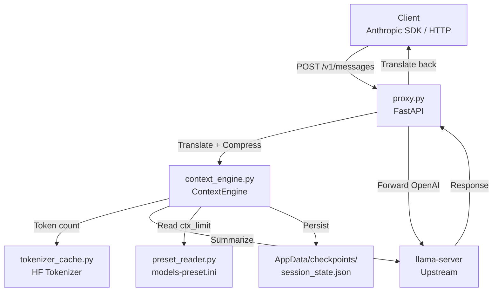

# Context Manager Proxy

**Active contributors:** vijay

Optional Python FastAPI service for Anthropic→OpenAI protocol translation, session compression, and context budget enforcement.

## Overview

The Context Manager Proxy sits between clients (Claude Code, custom apps) and `llama-server`. It translates the Anthropic Messages API to OpenAI's Chat Completions API, compresses long conversation histories via summarization, and enforces a context size limit (`ctx_limit`).

**Enabled via:** `context_manager.enabled = true` in `llo-config.json`
**Default ports:** Proxy `8090` → Upstream `llama-server` `8080`
**Launch:** `powershell -File script/StartContextManager.ps1`

## Architecture



## Components

### `proxy.py` — FastAPI server

**Responsibilities:**
- HTTP server on `proxy_port` (default 8090)
- Request/response translation: Anthropic ↔ OpenAI
- Session ID extraction (headers → body metadata → x-request-id → UUID)
- Streaming support (SSE for both protocols)
- Tool call passthrough

**Key functions:**
```python
# Protocol translation
convert_anthropic_to_openai_messages(body) -> List[Dict]
convert_openai_to_anthropic_response(openai_resp, request_id) -> Dict
normalize_system_messages(messages) -> List[Dict]
convert_anthropic_tools_to_openai(tools) -> List[Dict]

# Streaming
forward_stream_anthropic(response, client, session_id, engine)
forward_stream_openai(response, client)
```

**Session ID priority:**
1. `x-llm-session-id` header
2. `x-session-id` header
3. `metadata.session_id` in request body
4. `x-request-id` header → `session_{uuid}`
5. Random UUID fallback

### `context_engine.py` — Compression engine

**Core class:** `ContextEngine`

```python
class ContextEngine:
    def __init__(
        self,
        warn_threshold: float = 0.70,      # Trigger at 70% of ctx_limit
        keep_turns: int = 6,               # Preserve last N turns uncompressed
        llama_server_url: str = "http://127.0.0.1:8080",
        summary_max_tokens: int = 768,     # Max tokens for summary response
        summarize_with_model: str = "same", # Model alias for summarization
        tokenizer_repo_override: str = "",  # Explicit HF repo
        eviction_interval_sec: int = 300,  # Stale session scan interval
        session_ttl_sec: int = 86400,      # Session inactivity TTL
    )
```

**Session state (`SessionState`):**
```python
class SessionState:
    session_id: str
    messages: List[Dict]           # Full conversation history
    compressed_history: List[Dict] # Summarized blocks
    last_accessed: float           # Unix timestamp
    checksum: str                  # SHA256 of turns to summarize (idempotency)
```

**Compression policy:**
```python
def needs_compression(self, session: SessionState, max_tokens_requested: int) -> bool:
    # Triggers when:
    prompt_tokens + max_tokens_requested >= ctx_limit * warn_threshold
```

**Compression flow:**
1. Keep last `keep_turns` turns uncompressed
2. Summarize older turns via `llama-server` (using `summarize_with_model`)
3. Replace summarized turns with `[Compressed History Summary]` system block
4. Clamp total tokens to `85% * ctx_limit` (safety margin)
5. Idempotency: SHA256 of turns-to-summarize; skip if unchanged

**Background tasks:**
- Eviction loop: scans sessions every `eviction_interval_sec`, removes if `last_accessed > session_ttl_sec`
- Checkpoint persistence: saves session state to `%APPDATA%\LLM Manager\checkpoints\{session_id}.json`

### `tokenizer_cache.py` — Shared HF tokenizer

**Features:**
- Alias normalization: `claude-3-5-sonnet-20241022` → `anthropic/claude-3.5-sonnet`
- Persistent token-count cache (file-based)
- Per-repo overrides via `tokenizer_repo` config
- Lazy loading: tokenizer fetched on first use

```python
def get_tokenizer(model_alias: str) -> PreTrainedTokenizerFast:
    # Normalize alias → HF repo ID
    # Load from cache or download
    # Return tokenizer
```

### `preset_reader.py` — models-preset.ini parser

```python
def read_preset_ctx_limit(preset_path: str) -> int:
    # Parses models-preset.ini for active model's ctx_size
    # Returns 0 if not found (falls back to 65536 in config)
```

### `config.py` — Pydantic settings

```python
class ContextManagerConfig(BaseModel):
    enabled: bool = False
    warn_threshold: float = 0.70
    keep_turns: int = 6
    proxy_port: int = 8090
    llama_server_url: str = "http://127.0.0.1:8080"
    ctx_limit: int = 0              # 0 = auto from preset
    tokenizer_repo: str = ""
    summary_max_tokens: int = 768
    summarize_with_model: str = "same"
    eviction_interval_sec: int = 300
    session_ttl_sec: int = 86400
```

**Config resolution:** Reads `context_manager` block from `llo-config.json` in AppData (same as Tauri).

## Compression algorithm detail

```mermaid
sequenceDiagram
    Client->>Proxy: POST /v1/messages (Anthropic)
    Proxy->>Proxy: Extract session_id
    Proxy->>Engine: get_or_create_session(session_id)
    Engine->>Engine: count_tokens_messages(messages)
    alt needs_compression
        Engine->>Engine: _compute_hash(to_summarize)
        alt hash unchanged (idempotent)
            Engine-->>Proxy: Return existing compressed_history
        else
            Engine->>LlamaServer: POST /v1/chat/completions (summarization prompt)
            LlamaServer-->>Engine: Summary response
            Engine->>Engine: Build compressed_history + [Compressed Summary] block
            Engine->>Engine: _clamp_message_tokens(85% ctx_limit)
            Engine->>Disk: Save checkpoint
    end
    Engine-->>Proxy: Compressed message list
    Proxy->>Proxy: Convert Anthropic → OpenAI format
    Proxy->>LlamaServer: POST /v1/chat/completions (OpenAI)
    LlamaServer-->>Proxy: Response (streaming or non-streaming)
    Proxy->>Proxy: Convert OpenAI → Anthropic format
    Proxy-->>Client: Response
```

## Configuration

```json
{
  "context_manager": {
    "enabled": true,
    "warn_threshold": 0.70,
    "keep_turns": 6,
    "proxy_port": 8090,
    "llama_server_url": "http://127.0.0.1:8080",
    "ctx_limit": 0,
    "tokenizer_repo": "",
    "summary_max_tokens": 768,
    "summarize_with_model": "same",
    "eviction_interval_sec": 300,
    "session_ttl_sec": 86400
  }
}
```

| Setting | Default | Description |
|---------|---------|-------------|
| `enabled` | `false` | Master switch |
| `warn_threshold` | `0.70` | Compression trigger at `tokens + max_tokens >= ctx_limit * threshold` |
| `keep_turns` | `6` | Recent turns preserved uncompressed |
| `proxy_port` | `8090` | Proxy listen port |
| `llama_server_url` | `http://127.0.0.1:8080` | Upstream llama-server |
| `ctx_limit` | `0` | Context limit; 0 = auto from `models-preset.ini` |
| `tokenizer_repo` | `""` | Explicit HF tokenizer repo override |
| `summary_max_tokens` | `768` | Max tokens for summarization response |
| `summarize_with_model` | `"same"` | Model alias for summarization |
| `eviction_interval_sec` | `300` | Stale session scan interval |
| `session_ttl_sec` | `86400` | Session inactivity TTL (24h) |

## Running the proxy

### Via PowerShell (recommended)

```powershell
powershell -File script/StartContextManager.ps1 [-Port 8090] [-ConfigFile <path>]
```

### Direct Python (development)

```bash
cd llo-core/context_manager
.venv/bin/activate
python -m uvicorn proxy:app --host 0.0.0.0 --port 8090 --log-level debug
```

### Client configuration

**Claude Code:**
```bash
ANTHROPIC_BASE_URL=http://127.0.0.1:8090 \
ANTHROPIC_AUTH_TOKEN=local \
CLAUDE_CODE_DISABLE_NONESSENTIAL_TRAFFIC=1 \
claude
```

**Cursor / Continue / OpenAI SDK:**
```json
{
  "baseURL": "http://127.0.0.1:8090/v1",
  "apiKey": "local"
}
```

## Testing

```bash
cd llo-core/context_manager
.venv/bin/activate
pytest tests/ -v

# Specific modules
pytest tests/test_compression.py -v
pytest tests/test_token_counting.py -v
pytest tests/test_protocol_conversion.py -v
pytest tests/test_http_roundtrip.py -v
```

**Test coverage (11 modules):**
| Test file | Coverage |
|-----------|----------|
| `test_compression.py` | Compression logic, idempotency, clamping |
| `test_token_counting.py` | Tokenizer accuracy, alias normalization |
| `test_session_tracking.py` | Session state, checkpoints, eviction |
| `test_protocol_conversion.py` | Anthropic↔OpenAI translation, tools, streaming |
| `test_http_roundtrip.py` | Full proxy integration with mock upstream |
| `test_checkpoint_persistence.py` | Disk save/load, corruption handling |
| `test_needs_compression.py` | Heuristic validation, edge cases |
| `test_tokenizer_cache.py` | Alias normalization, caching, overrides |
| `test_preset_reader.py` | models-preset.ini parsing |
| `test_config.py` | Pydantic validation, defaults |
| `test_proxy_lifespan.py` | Startup/shutdown, background tasks |

## Key source files

| File | Purpose |
|------|---------|
| `llo-core/context_manager/proxy.py` | FastAPI server, protocol translation, streaming |
| `llo-core/context_manager/context_engine.py` | Compression, token counting, checkpoints, eviction |
| `llo-core/context_manager/tokenizer_cache.py` | Shared HF tokenizer, alias normalization, cache |
| `llo-core/context_manager/preset_reader.py` | models-preset.ini parser for ctx_limit |
| `llo-core/context_manager/config.py` | Pydantic settings model |
| `llo-core/context_manager/tests/` | 11 pytest modules |
| `script/StartContextManager.ps1` | PowerShell launcher |
| `ui/src-tauri/src/commands/config.rs` | Reads CM config for Claude Code launch |
