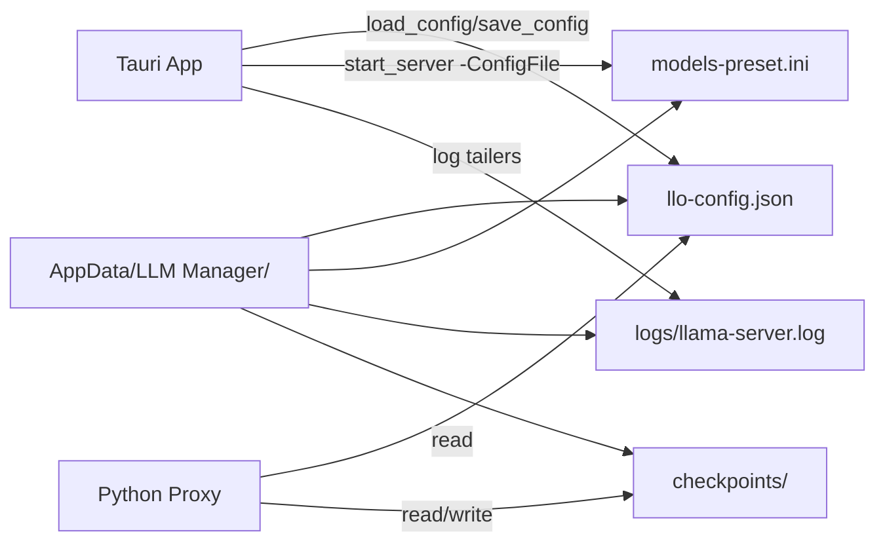

# Tauri Desktop App

**Active contributors:** vijay

Native desktop GUI for LLM Manager built with Tauri 2, React 18, TypeScript, and Rust.

## Architecture overview

```mermaid
graph TB
    subgraph "Frontend (React + TypeScript)"
        Pages[Pages\nOverview, Models,\nPerformance, Settings,\nDiagnostics, Logs, Integrations]
        Stores[Zustand Stores\nhardware, config, server,\nmodels, validation]
        Components[Components\nPageShell, ImpactBanner,\nInfoTooltip, Layout]
        Lib[lib/validation.ts\nExact KV Calculator]
    end

    subgraph "IPC Layer"
        Invoke[@tauri-apps/api/core\ninvoke()]
        Events[@tauri-apps/api/event\nlisten()]
    end

    subgraph "Backend (Rust)"
        Commands[Tauri Commands\nconfig, profile, server,\nmodels, gguf, health]
        Scripts[scripts.rs\nWorkspace Resolution]
        PSBridge[run_powershell_script\nPS Dispatch]
        LogTail[Log Tailers\nstdout/stderr streaming]
    end

    subgraph "PowerShell Core"
        ProfilePS[Profile.ps1]
        RouterPS[SetupRouter.ps1]
        StartPS[start-server.ps1]
        StopPS[stop-server.ps1]
        HealthPS[test-health.ps1]
    end

    Pages --> Stores
    Pages --> Components
    Stores --> Invoke
    Components --> Invoke
    Invoke --> Commands
    Commands --> Scripts
    Commands --> PSBridge
    PSBridge --> ProfilePS
    PSBridge --> RouterPS
    PSBridge --> StartPS
    PSBridge --> StopPS
    PSBridge --> HealthPS
    Commands --> LogTail
    LogTail --> Events
    Events --> Stores
```

## Frontend structure (`ui/src/`)

```
ui/src/
├── pages/
│   ├── Overview.tsx        # Hardware profile, model launch, live logs
│   ├── Models.tsx          # GGUF scanner, binary inspector, template matching
│   ├── Performance.tsx     # Override sliders (ctx, n_gpu_layers, ubatch, cache, etc.)
│   ├── Settings.tsx        # Config editor (paths, integrations, fallback, context mgr)
│   ├── Diagnostics.tsx     # Exact KV cache calc, hardware validation
│   ├── Logs.tsx            # Full log viewer with filtering
│   └── Integrations.tsx    # Client setup helpers (Claude Code, Cursor, Continue)
├── store/
│   ├── hardwareStore.ts    # Hardware profile + fetch
│   ├── configStore.ts      # Config CRUD + save
│   ├── serverStore.ts      # Server status, logs, port
│   ├── modelsStore.ts      # GGUF list + fetch
│   └── validationStore.ts  # Pre-flight launch checks
├── components/
│   ├── layout/PageShell.tsx
│   ├── ImpactBanner.tsx    # Severity banners (block/warn/caution/info)
│   ├── InfoTooltip.tsx     # Hover help with recommendation/impact
│   └── __tests__/          # Vitest component tests
├── lib/
│   └── validation.ts       # Exact KV cache calculator (UI-side)
├── App.tsx                 # Router + providers
├── main.tsx                # Entry point
└── styles/                 # CSS modules per page
```

### Key pages

| Page | Purpose | Key stores |
|------|---------|------------|
| **Overview** | Hardware profile, model select, launch/stop, live logs (100 lines) | hardware, config, server, models, validation |
| **Models** | Recursive GGUF scan, binary header inspector, template matching, mmproj pairing | models, config, hardware |
| **Performance** | Sliders for all overrides (ctx_size, n_gpu_layers, ubatch, cache_type, parallel, spec_type, etc.) | config, hardware |
| **Settings** | Paths, integrations, fallback provider, context manager, template selection | config |
| **Diagnostics** | Exact KV cache math (bytes/element), hardware validation, config audit | validation, hardware, config |
| **Logs** | Full log viewer with level filter, search, export | server |
| **Integrations** | Client config generators (Claude Code env, Cursor JSON, Continue JSON) | config, server |

### Zustand stores

```typescript
// hardwareStore.ts
{ profile, loading, error, fetchHardware() }

// configStore.ts
{ config, loading, error, fetchConfig(), updateConfig(partial), saveConfig() }

// serverStore.ts
{ status, port, logs[], clearLogs(), setPendingRestart() }

// modelsStore.ts
{ models[], loading, fetchModels(modelsDir) }

// validationStore.ts
{ assessments[] }  // Pre-flight checks per model
```

### Validation library (`lib/validation.ts`)

**Exact KV cache calculator** (differs from CLI approximation):

```typescript
// CLI: q8_0 = 50% of f16, q4_0 = 25% of f16
// UI: exact byte sizes
const BYTES_PER_ELEMENT = {
  f16: 2.0,
  q8_0: 1.0625,   // 53.1% of f16
  q4_0: 0.5625,   // 28.1% of f16
};
```

Used in Diagnostics page and Overview pre-flight checks.

## Backend structure (`ui/src-tauri/src/`)

```
ui/src-tauri/src/
├── commands/
│   ├── config.rs       # load_config, save_config (AppData directory)
│   ├── profile.rs      # detect_hardware (bridges Profile.ps1 -Json)
│   ├── server.rs       # start_server, stop_server, get_server_status, log tailing
│   ├── models.rs       # scan_models (recursive GGUF + binary parser)
│   ├── gguf.rs         # parse_gguf_file (binary header metadata)
│   └── health.rs       # run_health_check (dispatches test-health.ps1)
├── scripts.rs          # get_workspace_root, get_user_data_dir, get_user_log_dir, run_powershell_script
├── main.rs             # Tauri app entry, command registration
└── tray.rs             # System tray (optional)
```

### Command pattern

All commands follow this pattern:

```rust
#[tauri::command]
pub async fn command_name(app: AppHandle, params: Params) -> Result<ReturnType, String> {
    // 1. Resolve paths via scripts.rs
    // 2. Dispatch PowerShell via run_powershell_script()
    // 3. Parse JSON output
    // 4. Return typed result
}
```

### PowerShell bridge (`scripts.rs`)

```rust
pub fn run_powershell_script(script_relative_path: &str, args: &[&str]) -> Result<String, String> {
    // 1. Resolve workspace root (dev: CARGO_MANIFEST_DIR; release: exe parent + resources)
    // 2. Find script in candidate locations
    // 3. Execute: powershell.exe -ExecutionPolicy Bypass -File <script> <args> (Windows)
    //            pwsh -File <script> <args> (macOS/Linux)
    // 4. Return stdout or Err(stderr)
}
```

**Workspace root resolution priority:**
1. `CARGO_MANIFEST_DIR` (dev mode)
2. `current_exe()` parent + `resources/` (release bundle)
3. Walk up from CWD (fallback)

### Log tailing (`server.rs`)

```rust
async fn emit_log_file_lines(app: AppHandle, path: PathBuf, default_level: &str) {
    // Opens file, seeks to end, reads new lines in loop
    // Classifies level from llama-server log prefix (I/W/E)
    // Emits "server-log" Tauri event per line
    // Handles rotation/truncation detection
}
```

Two concurrent tasks: stdout → `INFO`, stderr → `ERROR`.

### Config management (`config.rs`)

```rust
pub fn get_config_path() -> PathBuf {
    get_user_data_dir().join("llo-config.json")
}

#[tauri::command]
pub fn load_config() -> Result<AppConfig, String> {
    // Reads AppData config, returns typed struct
}

#[tauri::command]
pub fn save_config(config: AppConfig) -> Result<(), String> {
    // Writes AppData config, creates dir if needed
}
```

**AppConfig** mirrors TypeScript `AppConfig` interface (camelCase serialization).

## Development workflow

### Dev mode

```bash
cd ui
npm run tauri dev
```

- Vite dev server (hot reload) + `cargo run` (Rust backend)
- Opens DevTools automatically
- PowerShell scripts executed from workspace root

### Production build

```bash
cd ui
npm run tauri build --release
```

Outputs:
- Windows: `src-tauri/target/release/bundle/nsis/llm-manager_*_x64_en-US.msi`
- macOS: `src-tauri/target/release/bundle/dmg/llm-manager_*_aarch64.dmg`
- Linux: `src-tauri/target/release/bundle/appimage/llm-manager_*_amd64.AppImage`

### Testing

```bash
# Frontend
cd ui
npm run test:run          # Vitest
npm run build             # TypeScript check (tsc)

# Backend
cd ui/src-tauri
cargo test                # Unit tests
cargo clippy              # Lints
cargo fmt --check         # Format
```

## Configuration directory split



**Key point:** Tauri reads/writes **AppData config**, not workspace root. PowerShell scripts receive `-ConfigFile` pointing to AppData.

## Key source files

| File | Purpose |
|------|---------|
| `ui/src/pages/Overview.tsx` | Main dashboard: hardware, model launch, logs |
| `ui/src/pages/Models.tsx` | GGUF scanner, binary inspector, mmproj pairing |
| `ui/src/pages/Performance.tsx` | Override sliders for all inference params |
| `ui/src/pages/Settings.tsx` | Config editor (paths, integrations, fallback, CM) |
| `ui/src/pages/Diagnostics.tsx` | Exact KV calc, validation |
| `ui/src/store/hardwareStore.ts` | Hardware profile state |
| `ui/src/store/configStore.ts` | Config CRUD |
| `ui/src/store/serverStore.ts` | Server status, logs, port |
| `ui/src/store/modelsStore.ts` | GGUF list |
| `ui/src/store/validationStore.ts` | Pre-flight assessments |
| `ui/src/lib/validation.ts` | Exact KV cache calculator |
| `ui/src-tauri/src/commands/config.rs` | Config load/save (AppData) |
| `ui/src-tauri/src/commands/profile.rs` | Hardware detection bridge |
| `ui/src-tauri/src/commands/server.rs` | Start/stop, log tailing |
| `ui/src-tauri/src/commands/models.rs` | GGUF scan + binary parse |
| `ui/src-tauri/src/commands/gguf.rs` | GGUF metadata extraction |
| `ui/src-tauri/src/commands/health.rs` | Health check dispatcher |
| `ui/src-tauri/src/scripts.rs` | Workspace resolution, PS dispatch |
