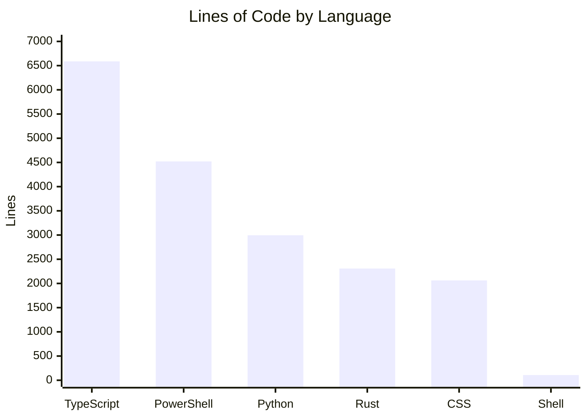
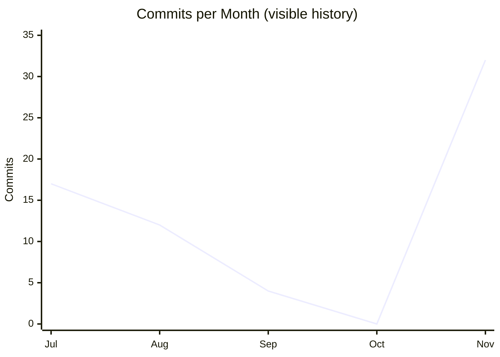

# By the numbers

**Data collected on 2026-11-22.** Codebase statistics snapshot for the `develop` branch of the LLM Manager repository (`E:\Projects\llm-manager`). All paths are relative to the repository root unless noted. Measurements exclude `.git`, `node_modules`, `target/`, `nakshastra-out/`, `droid-wiki/`, `docs/`, `grammars/`, and vendored/generated assets unless stated.

## Size

### Lines of code by language

Measured across tracked source, test, and configuration files.

| Language | Files | Lines | Share of tracked source |
|----------|-------|-------|-------------------------|
| TypeScript | 39 | 6,588 | ~40% |
| PowerShell | 12 | 4,521 | ~28% |
| Python | 19 | 2,996 | ~18% |
| Rust | 11 | 2,308 | ~14% |
| CSS | 15 | 2,062 | ~13% |
| Shell | 6 | 107 | <1% |

JSON/Config files (16 files, ~18,000 lines) are dominated by `ui/package-lock.json`, `.cached_flags.json`, and generated Tauri schemas under `ui/src-tauri/gen/schemas/`, and are excluded from the chart above. Markdown files add ~930 lines across roughly 10 files (`README.md`, `ARCHITECTURE.md`, `USER_GUIDE.md`, `CLAUDE.md`, `AGENTS.md`, `CONTRIBUTING.md`, `DISCUSSION.md`, `IDEA.md`, plus readmes under `llo-core/`); `llo-config.json` and `models-preset.ini` are configuration, not Markdown.

### Source vs test vs config

| Category | Files | Lines | Notes |
|----------|-------|-------|-------|
| Source code | 86 | ~17,300 | PowerShell, Python, Rust, TypeScript source |
| Test files | 27 | ~2,200 | 11 pytest modules under `llo-core/context_manager/tests/`; 16 vitest/React test files under `ui/src/` |
| Configuration | 16 | ~18,000 | Lockfiles, generated schemas, `tauri.conf.json`, `llo-config.json`, `models-preset.ini` |

### Package/module count

| Area | Modules/files | Description |
|------|---------------|-------------|
| `llo-core/` | 6 PowerShell modules | `Profile.ps1`, `SetupRouter.ps1`, `ParseHelp.ps1`, `GitDiff.ps1`, `FetchAssets.ps1`, `Paths.ps1` |
| `script/` | 6 PowerShell + 5 shell wrappers | `main.ps1`, `start-server.ps1`, `stop-server.ps1`, `test-health.ps1`, `verify-scripts.ps1`, `StartContextManager.ps1` |
| `llo-core/context_manager/` | 6 Python modules + 11 test modules | `proxy.py`, `context_engine.py`, `tokenizer_cache.py`, `preset_reader.py`, `config.py`, `__init__.py` |
| `ui/src-tauri/src/commands/` | 7 Rust command modules | `server.rs`, `config.rs`, `gguf.rs`, `health.rs`, `models.rs`, `profile.rs`, `scripts.rs` |
| `ui/src/` | 39 TypeScript files | Pages, Zustand stores, lib, components, hooks |

## Activity

### Recent commit trend

Visible history on `develop` runs from **11 July 2026** (initial commit) to **22 November 2026** — 65 commits, all human-attributed (see Bot-attributed commits below).

Commits per month: July 17, August 12, September 4, October 0 (none visible), November 32. November alone accounts for roughly half of all visible commits, driven by the comprehensive update and CI-hardening push (PR #4 and its follow-ups).

### Churn hotspots

Files with the most commits touching them across visible history:

| File | Commits touching file | Primary area |
|------|----------------------|--------------|
| `llo-core/SetupRouter.ps1` | 24 | Parameter derivation + preset generation |
| `script/start-server.ps1` | 19 | Server lifecycle |
| `main.ps1` | 17 | Setup wizard |
| `ui/src/pages/Overview.tsx` | 13 | Main dashboard |
| `script/test-health.ps1` | 11 | Health-check orchestration |
| `ui/src-tauri/src/commands/server.rs` | 10 | Tauri server commands |
| `llo-core/ParseHelp.ps1` | 10 | llama.cpp flag compatibility |
| `llo-core/Profile.ps1` | 9 | Hardware profiling |
| `script/verify-scripts.ps1` | 9 | CLI flag verification |

`llo-core/` and `ui/` are the most active areas, consistent with the project's split between the PowerShell orchestration core and the Tauri desktop UI.

## Bot-attributed commits

| Bot | Commits | Percentage |
|-----|---------|------------|
| — | 0 | 0% |

The project is a solo effort: 64 commits by Vijay Tank and 1 by `vijay10` on `develop`. There are **no bot-attributed commits** — no Dependabot, no GitHub Actions bot commits, no automation bots show up in git history. This is stated for transparency; inline AI assistance (if any) leaves no trace in git history.

*Note: contributor leaderboards are intentionally omitted for this solo project.*

## Complexity

### Average file size by directory

| Directory | Files | Approx. avg lines | Largest file in directory |
|-----------|-------|-------------------|---------------------------|
| `ui/src-tauri/gen/schemas/` | 4 | ~1,850 | generated Tauri schemas |
| `llo-core/` (PowerShell root) | 6 | ~340 | `SetupRouter.ps1` (891) |
| `script/` | 5 PowerShell | ~326 | `start-server.ps1` (643) |
| `ui/src-tauri/src/commands/` | 7 | ~280 | `server.rs` (681) |
| `ui/src/pages/` | 22 | ~238 | `Overview.tsx` (696) |
| `ui/src/lib/` | 4 | ~236 | `validation.ts` (307) |
| `ui/src-tauri/src/` | 10 | ~230 | `scripts.rs` (213) |
| `llo-core/context_manager/` | 19 | ~157 | `proxy.py` (1,043) |

Averages include co-located CSS/shell files; generated schema files skew `ui/src-tauri/gen/schemas/` upward.

### Deepest import chains

Internal import chains appear to top out at about three hops:

- `llo-core/context_manager/proxy.py` → `llo-core/context_manager/context_engine.py` → `llo-core/context_manager/tokenizer_cache.py` / `preset_reader.py`
- `ui/src/pages/Overview.tsx` → `ui/src/lib/validation.ts`
- `ui/src/pages/Overview.tsx` → `ui/src/store/*` (Zustand stores)

Most modules import directly from standard libraries or external crates/packages, so deep intra-repo chains are uncommon.

### Exported symbols per package

| Package | Exported/public symbols | Modules |
|---------|------------------------|---------|
| `llo-core/context_manager/` (Python) | ~51 defs/classes | `proxy.py` (~28), `context_engine.py` (~13), `tokenizer_cache.py` (~5), `preset_reader.py` (~3), `config.py` (~2) |
| `llo-core/` (PowerShell) | ~20 functions | `SetupRouter.ps1` (~8), `Profile.ps1` (~3), `ParseHelp.ps1` (~2), `Paths.ps1` (~3), `FetchAssets.ps1` (~3), `GitDiff.ps1` (~1) |
| `ui/src-tauri/src/commands/` (Rust) | ~29 `pub` items | `config.rs` (~6), `health.rs` (~5), `profile.rs` (~5), `server.rs` (~4), `scripts.rs` (~4), `gguf.rs` (~3), `models.rs` (~2) |
| `ui/src/` (TypeScript) | ~40 exports | `validation.ts` (~9), `configStore.ts` (~5), `configSchema.ts` (~2), stores and page components |

Symbol counts are approximate (pattern-based over `def`/`class`/`function`/`export`/`pub` declarations) and include module-internal exports.

## Related pages

- [Overview](overview/index.md) — what LLM Manager does and how it's structured
- [Getting started](overview/getting-started.md) — prerequisites, install, build, test, run
- [Systems index](systems/index.md) — systems overview (profiling, derivation, server lifecycle, GGUF, configuration, compatibility guard)
- [Applications index](applications/index.md) — applications overview (PowerShell CLI, Tauri desktop app, context manager proxy)
- [Lore](lore.md) — narrative history and era timeline
- [Fun facts](fun-facts.md) — light notes on origins, age, and trivia
