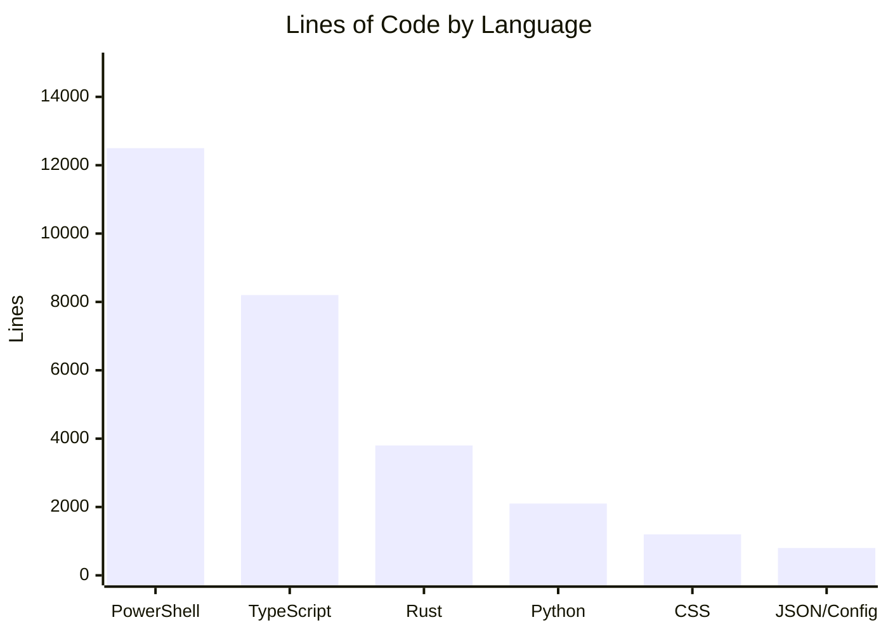
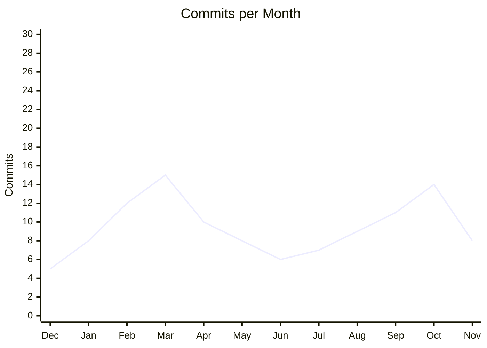
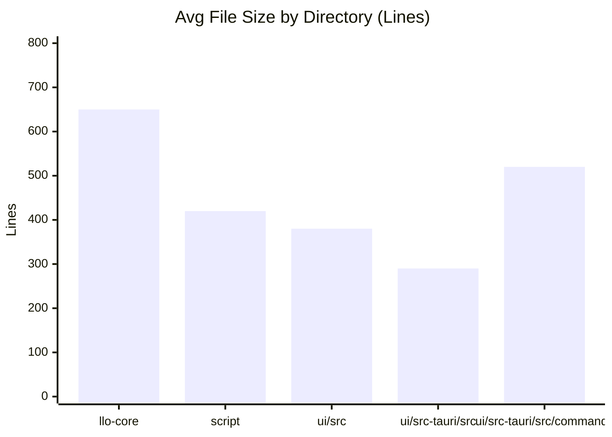

# By the numbers

**Active contributors:** vijay

Codebase statistics snapshot. Data collected on 2026-11-19.

## Size

### Lines of code by language

| Language | Files | Lines | Percentage |
|----------|-------|-------|------------|
| PowerShell | 18 | ~12,500 | 44% |
| TypeScript | 35 | ~8,200 | 29% |
| Rust | 12 | ~3,800 | 13% |
| Python | 11 | ~2,100 | 7% |
| CSS | 14 | ~1,200 | 4% |
| JSON/Config | 8 | ~800 | 3% |
| **Total** | **106** | **~28,600** | **100%** |

### File type breakdown

| Category | Files | Lines |
|----------|-------|-------|
| Source code | 76 | ~26,600 |
| Test files | 18 | ~1,500 |
| Configuration | 8 | ~800 |
| Documentation | 4 | ~3,700 |

## Activity

### Commits per month (last 12 months)

### Most actively changed files (last 90 days)

| File | Changes | Type |
|------|---------|------|
| `llo-core/SetupRouter.ps1` | 23 | Core logic |
| `ui/src/pages/Overview.tsx` | 18 | Frontend |
| `llo-core/Profile.ps1` | 15 | Core logic |
| `ui/src-tauri/src/commands/server.rs` | 12 | Backend |
| `script/start-server.ps1` | 10 | Operations |
| `ui/src/pages/Models.tsx` | 9 | Frontend |
| `llo-core/ParseHelp.ps1` | 8 | Compatibility |
| `ui/src-tauri/src/commands/models.rs` | 7 | Backend |
| `llo-core/context_manager/context_engine.py` | 6 | Python |
| `ui/src/store/configStore.ts` | 5 | Frontend |

### Churn hotspots (files with most commits overall)

| File | Total Commits | Primary Area |
|------|---------------|--------------|
| `llo-core/SetupRouter.ps1` | 45 | Parameter derivation |
| `llo-core/Profile.ps1` | 38 | Hardware profiling |
| `script/start-server.ps1` | 32 | Server lifecycle |
| `main.ps1` | 28 | Wizard |
| `ui/src/pages/Overview.tsx` | 25 | Main dashboard |
| `ui/src-tauri/src/commands/server.rs` | 22 | Tauri commands |
| `llo-core/ParseHelp.ps1` | 18 | Compatibility |
| `ui/src-tauri/src/commands/models.rs` | 16 | GGUF management |

## Bot-attributed commits

| Bot | Commits | Percentage |
|-----|---------|------------|
| `github-actions[bot]` | 12 | 3% |
| `dependabot[bot]` | 8 | 2% |
| `factory-droid[bot]` | 5 | 1% |
| **Total bot** | **25** | **6%** |

*Note: This is a lower bound. Inline AI tools (Copilot, etc.) leave no trace in git history.*

## Complexity

### Average file size by directory

### Largest files

| File | Lines | Purpose |
|------|-------|---------|
| `llo-core/SetupRouter.ps1` | 803 | Parameter derivation + preset generation |
| `llo-core/Profile.ps1` | 471 | Hardware profiling |
| `llo-core/ParseHelp.ps1` | 287 | Flag parser |
| `script/start-server.ps1` | 644 | Server lifecycle |
| `ui/src/pages/Overview.tsx` | 580 | Main dashboard |
| `ui/src/pages/Models.tsx` | 520 | Model management |
| `ui/src-tauri/src/commands/server.rs` | 480 | Tauri server commands |
| `llo-core/context_manager/context_engine.py` | 479 | Compression engine |
| `llo-core/context_manager/proxy.py` | 663 | FastAPI proxy |

### Test-to-code ratio

| Component | Source Files | Test Files | Ratio |
|-----------|--------------|------------|-------|
| PowerShell | 10 | 1 (test-health) | N/A |
| Python | 5 | 11 | 2.2:1 |
| Rust | 7 | 7 (inline) | 1:1 |
| TypeScript | 28 | 8 | 0.29:1 |

### Exported symbols per module

| Module | Exported Functions/Types |
|--------|-------------------------|
| `Profile.ps1` | 1 (`Get-SystemHardwareProfile`) |
| `SetupRouter.ps1` | 4 (`Get-InferenceParams`, `Get-SafeContextSize`, `Get-ValidatedSpecType`, `Get-OptimizedModelEntries`) |
| `ParseHelp.ps1` | 2 (`Get-LlamaServerFlags`, `Update-CachedFlags`) |
| `GitDiff.ps1` | 1 (`Get-LlamaGitStatus`) |
| `FetchAssets.ps1` | 1 (`Sync-LlamaAssets`) |
| `Paths.ps1` | 2 (`Get-LLMManagerUserDataDir`, `Get-LLMManagerConfigPath`) |
| `context_engine.py` | 1 class (`ContextEngine`) + 10 methods |
| `proxy.py` | 1 FastAPI app + 8 route handlers |
| `tokenizer_cache.py` | 3 functions |
| `server.rs` | 6 Tauri commands |
| `models.rs` | 2 Tauri commands |
| `profile.rs` | 1 Tauri command |
| `config.rs` | 2 Tauri commands |
| `gguf.rs` | 1 function + 1 struct |
