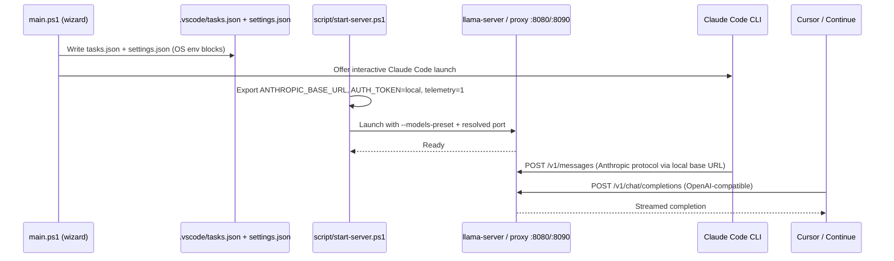

# Client Integrations

**Active contributors:** Vijay

Seamless setup for VSCode, Claude Code, Cursor, Continue, and generic OpenAI-compatible clients. The `main.ps1` wizard generates `.vscode/tasks.json` and `.vscode/settings.json`, exports Claude Code CLI environment variables, enforces Claude Code operational floors (`parallel=2`, `idle_timeout_sec>=600`), and the Tauri app generates copy-paste Cursor/Continue JSON blocks.

## Purpose

At the end of setup, `main.ps1` writes `.vscode/` into the workspace root with build/stop/audit tasks and OS-specific terminal environment variables, so clients run against the local `llama-server` (or the Context Manager Proxy on port 8090) without manual config. Claude Code is wired with `ANTHROPIC_BASE_URL`, `ANTHROPIC_AUTH_TOKEN=local`, and `CLAUDE_CODE_DISABLE_NONESSENTIAL_TRAFFIC=1`; Cursor and Continue are configured as OpenAI-compatible providers pointing at `http://127.0.0.1:<port>/v1` with API key `local`. See [applications/powershell-cli.md](../applications/powershell-cli.md) for the CLI wizard and [overview/architecture.md](../overview/architecture.md) for how integration fits the pipeline.

## Directory layout

```
main.ps1                          # Wizard: VSCode tasks/settings + integration offers
script/
├── start-server.ps1              # Env var export to shell (ANTHROPIC_BASE_URL etc.)
└── stop-server.ps1               # Graceful shutdown
ui/src-tauri/src/commands/server.rs  # launch_claude_terminal Tauri command
ui/src/pages/
├── Integrations.tsx              # Copy-paste config block generators
└── Overview.tsx                  # Model selector + Claude Code launch
.ui/ (workspace-generated by wizard)
└── .vscode/
    ├── tasks.json                # Start/Stop/Audit LLM Server tasks
    └── settings.json             # OS-specific terminal env vars
```

## Key Abstractions

| Abstraction | Responsibility | Primary interface |
|-------------|---------------|-------------------|
| `.vscode/tasks.json` | VSCode tasks: "Start LLM Server", "Stop LLM Server", "Audit LLM Manager" | Generated by `main.ps1` wizard |
| `.vscode/settings.json` | OS-specific `terminal.integrated.env.*` with `ANTHROPIC_BASE_URL`, `ANTHROPIC_AUTH_TOKEN=local`, etc. | Generated by `main.ps1` wizard |
| Claude Code env block | `ANTHROPIC_BASE_URL`, `ANTHROPIC_AUTH_TOKEN=local`, `CLAUDE_CODE_DISABLE_NONESSENTIAL_TRAFFIC=1`, `CLAUDE_CODE_ENABLE_GATEWAY_MODEL_DISCOVERY=1` | Exported by wizard + `start-server.ps1` |
| Claude Code operational floors | `parallel` floored at 2; `idle_timeout_sec` floored at 600 (10 min) | `llo-core/SetupRouter.ps1`, `script/start-server.ps1` |
| Cursor config | `openaiApiBase`/`openaiApiKey` as OpenAI-compatible provider | Manual `~/.cursor/settings.json` |
| Continue config | OpenAI provider with `apiBase`/`apiKey` | Manual `~/.continue/config.json` |

## How it works



### VSCode integration (wizard-generated)

The wizard creates `.vscode/` in the workspace root (only `tasks.json` is written if absent; `settings.json` is written/updated each run):

**`.vscode/tasks.json`:**
```json
{
  "version": "2.0.0",
  "tasks": [
    {
      "label": "Start LLM Server",
      "type": "shell",
      "command": "powershell.exe",
      "args": ["-ExecutionPolicy", "Bypass", "-File", "script/start-server.ps1"],
      "group": "build",
      "presentation": { "reveal": "always", "panel": "new" }
    },
    {
      "label": "Stop LLM Server",
      "type": "shell",
      "command": "powershell.exe",
      "args": ["-File", "script/stop-server.ps1"]
    },
    {
      "label": "Audit LLM Manager",
      "type": "shell",
      "command": "powershell.exe",
      "args": ["-File", "script/test-health.ps1"],
      "group": "test"
    }
  ]
}
```

**`.vscode/settings.json`** — one env block per OS (`windows`, `osx`, `linux`):
```json
{
  "terminal.integrated.env.windows": {
    "LLAMA_BASE_URL": "http://127.0.0.1:8080",
    "LLAMA_OPENAI_BASE_URL": "http://127.0.0.1:8080/v1",
    "OPENAI_BASE_URL": "http://127.0.0.1:8080/v1",
    "OPENAI_API_BASE": "http://127.0.0.1:8080/v1",
    "OPENAI_API_KEY": "local-key",
    "ANTHROPIC_BASE_URL": "http://127.0.0.1:8080",
    "ANTHROPIC_AUTH_TOKEN": "local",
    "ANTHROPIC_API_KEY": "local-key",
    "CLAUDE_CODE_ENABLE_GATEWAY_MODEL_DISCOVERY": "1",
    "CLAUDE_CODE_DISABLE_NONESSENTIAL_TRAFFIC": "1"
  }
}
```

Usage: open the workspace in VSCode, then `Ctrl+Shift+B` → "Start LLM Server" (runs in the integrated terminal with env vars pre-set). Shell command is `powershell.exe` on Windows and `pwsh` on macOS/Linux.

### Claude Code integration

**Config:** `"integrations": ["claude-code"]` in `llo-config.json`.

**Effects when active:**
- `parallel` floored at 2 (prevents subagent deadlocks) — enforced in `llo-core/SetupRouter.ps1`
- `idle_timeout_sec` floored at 600 seconds (10 min, prevents mid-task sleeps) — enforced in `script/start-server.ps1` and passed to llama-server as `--sleep-idle-seconds`
- Routes to the Context Manager Proxy port (8090) when `context_manager.enabled` is true, otherwise the server port (8080)

**Launch methods:**
1. **Wizard interactive offer** at the end of `main.ps1`: `Launch Claude Code now? [Y/n]`
2. **Tauri Overview page** — "Launch Claude Code" button
3. **Tauri command** `launch_claude_terminal` (`ui/src-tauri/src/commands/server.rs`): builds a PowerShell snippet setting `ANTHROPIC_BASE_URL`, `ANTHROPIC_AUTH_TOKEN='local'`, `CLAUDE_CODE_DISABLE_NONESSENTIAL_TRAFFIC='1'`, `CLAUDE_CODE_ENABLE_GATEWAY_MODEL_DISCOVERY='1'`, then spawns a terminal running `claude --model <active>`
4. **Manual:**
   ```bash
   ANTHROPIC_BASE_URL=http://127.0.0.1:8080 \
   ANTHROPIC_AUTH_TOKEN=local \
   CLAUDE_CODE_DISABLE_NONESSENTIAL_TRAFFIC=1 \
   CLAUDE_CODE_ENABLE_GATEWAY_MODEL_DISCOVERY=1 \
   claude --model local
   ```

`--model local` uses the alias from `models-preset.ini` (first model by default).

### Cursor integration

`~/.cursor/settings.json` or the Settings UI:
```json
{
  "openaiApiBase": "http://127.0.0.1:8080/v1",
  "openaiApiKey": "local"
}
```
With the Context Manager Proxy enabled, point `openaiApiBase` at `http://127.0.0.1:8090/v1`. Set the model to a `models-preset.ini` alias in Cursor's model dropdown or `.cursorrules`.

### Continue integration

`~/.continue/config.json`:
```json
{
  "models": [
    {
      "title": "Local LLM Manager",
      "provider": "openai",
      "model": "my-model",
      "apiBase": "http://127.0.0.1:8080/v1",
      "apiKey": "local",
      "contextLength": 32768
    }
  ],
  "tabAutocompleteModel": {
    "title": "Local Autocomplete",
    "provider": "openai",
    "model": "my-model",
    "apiBase": "http://127.0.0.1:8080/v1",
    "apiKey": "local"
  }
}
```
With the proxy enabled, use `http://127.0.0.1:8090/v1`. The model must match a `models-preset.ini` alias.

### Generic OpenAI-compatible client

```python
from openai import OpenAI
client = OpenAI(base_url="http://127.0.0.1:8080/v1", api_key="local")
response = client.chat.completions.create(
    model="my-model",
    messages=[{"role": "user", "content": "Hello"}]
)
```
Streaming:
```python
stream = client.chat.completions.create(model="my-model", messages=[...], stream=True)
for chunk in stream:
    print(chunk.choices[0].delta.content or "", end="")
```

### Tauri Integrations page (`Integrations.tsx`)

Generates copy-paste blocks for all clients — Claude Code (env vars + launch command), Cursor (JSON), Continue (JSON), generic OpenAI (curl). Shows the active server port (proxy port when CM is enabled), discovered models with aliases, and a one-click Claude Code launch button.

## Integration points

- [overview/architecture.md](../overview/architecture.md) — client env export as the final stage of the server launch pipeline.
- [systems/parameter-derivation.md](../systems/parameter-derivation.md) — `parallel` and `idle_timeout_sec` floors applied during derivation/server startup.
- [systems/compatibility-guard.md](../systems/compatibility-guard.md) — client-facing flags (`--sleep-idle-seconds`, `--models-preset`) validated against the binary.
- [applications/context-manager-proxy.md](../applications/context-manager-proxy.md) — clients route to port 8090 when the proxy is enabled.
- [applications/powershell-cli.md](../applications/powershell-cli.md) — wizard, start/stop lifecycle, env export.

## Entry points for modification

| Task | Entry point | File |
|------|-------------|------|
| Change VSCode tasks or settings shape | Wizard file writers | `main.ps1` |
| Change exported env vars | Env export block | `script/start-server.ps1` |
| Change Claude Code parallel/idle floors | `parallel < 2 → 2`; `idle_timeout_sec < 600 → 600` | `llo-core/SetupRouter.ps1`, `script/start-server.ps1` |
| Change Tauri launch command | `launch_claude_terminal` | `ui/src-tauri/src/commands/server.rs` |
| Change config-block generators | Integrations page | `ui/src/pages/Integrations.tsx` |
| Change model selector / launch button | Overview page | `ui/src/pages/Overview.tsx` |

## Key source files

| File | Purpose |
|------|---------|
| `main.ps1` | Wizard: `.vscode/tasks.json` and `.vscode/settings.json` generation, integration offers |
| `script/start-server.ps1` | Env var export to shell, idle timeout enforcement |
| `llo-core/SetupRouter.ps1` | Claude Code `parallel` floor at 2 |
| `ui/src-tauri/src/commands/server.rs` | `launch_claude_terminal` Tauri command |
| `ui/src/pages/Integrations.tsx` | Copy-paste config block generators |
| `ui/src/pages/Overview.tsx` | Model selector, Claude Code launch |
| `ui/src/store/configStore.ts` | Integration config state |

## Related Pages

- [overview/architecture.md](../overview/architecture.md) — hardware classification, decision flow, core formulas
- [systems/parameter-derivation.md](../systems/parameter-derivation.md) — models-preset.ini generation
- [systems/compatibility-guard.md](../systems/compatibility-guard.md) — llama-server argument compatibility
- [applications/context-manager-proxy.md](../applications/context-manager-proxy.md) — context manager proxy
- [applications/powershell-cli.md](../applications/powershell-cli.md) — PowerShell CLI wizard
