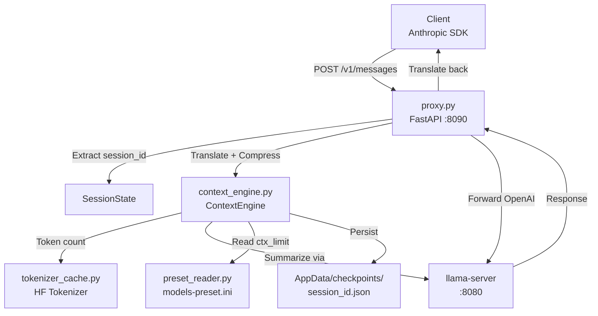

# Context Compression

**Active contributors:** vijay

Anthropic→OpenAI protocol translation, session summarization, and context budget enforcement via optional Python proxy.

## Overview

The Context Manager Proxy (`llo-core/context_manager/`) sits between clients and `llama-server`, translating the Anthropic Messages API to OpenAI's Chat Completions API, compressing long conversation histories via summarization, and enforcing a context size limit (`ctx_limit`).

## Architecture



## Compression policy

### Trigger condition

```python
def needs_compression(self, session: SessionState, max_tokens_requested: int) -> bool:
    prompt_tokens = self.count_tokens_messages(session.messages)
    return prompt_tokens + max_tokens_requested >= ctx_limit * warn_threshold
```

**Defaults:**
- `warn_threshold = 0.70` (70% of context limit)
- `ctx_limit = 0` → auto-read from `models-preset.ini` (fallback 65536)

### Compression algorithm

```python
async def compress(self, session: SessionState, max_allowed_tokens: int):
    # 1. Idempotency check
    to_summarize = session.messages[:-keep_turns]  # Older turns
    hash = self._compute_hash(session.id, to_summarize)
    if hash == session.checksum:
        return  # Unchanged delta, skip

    # 2. Request summary from llama-server
    summary_prompt = build_summary_prompt(to_summarize)
    summary = await self._request_summary(summary_prompt)

    # 3. Build compressed history
    compressed = [
        {"role": "system", "content": f"[Compressed History Summary]\n{summary}"}
    ] + session.messages[-keep_turns:]  # Keep last N turns

    # 4. Clamp to safety margin
    compressed = self._clamp_message_tokens(compressed, int(ctx_limit * 0.85))

    # 5. Update session
    session.compressed_history = compressed
    session.checksum = hash
    self._save_checkpoint_to_disk(session)
```

### Parameters

| Setting | Default | Description |
|---------|---------|-------------|
| `warn_threshold` | 0.70 | Trigger at 70% of ctx_limit |
| `keep_turns` | 6 | Recent turns preserved uncompressed |
| `summary_max_tokens` | 768 | Max tokens for summary response |
| `summarize_with_model` | "same" | Model alias for summarization |
| `ctx_limit` | 0 (auto) | Context limit; 0 = from preset |

## Protocol translation

### Anthropic → OpenAI (request)

```python
def convert_anthropic_to_openai_messages(body: Dict) -> List[Dict]:
    messages = []
    
    # System message(s)
    if body.get("system"):
        messages.append({"role": "system", "content": body["system"]})
    
    # Conversation messages
    for msg in body["messages"]:
        if msg["role"] == "user":
            messages.append({"role": "user", "content": msg["content"]})
        elif msg["role"] == "assistant":
            messages.append({"role": "assistant", "content": msg["content"]})
    
    # Tool calls passthrough
    if body.get("tools"):
        openai_tools = convert_anthropic_tools_to_openai(body["tools"])
    
    return messages
```

### OpenAI → Anthropic (response)

```python
def convert_openai_to_anthropic_response(openai_resp, request_id) -> Dict:
    choice = openai_resp["choices"][0]
    message = choice["message"]
    
    return {
        "id": request_id,
        "type": "message",
        "role": "assistant",
        "content": [{"type": "text", "text": message["content"]}],
        "model": openai_resp["model"],
        "stop_reason": map_finish_reason(choice["finish_reason"]),
        "usage": {
            "input_tokens": openai_resp["usage"]["prompt_tokens"],
            "output_tokens": openai_resp["usage"]["completion_tokens"]
        }
    }
```

### Streaming

Both protocols use SSE. Proxy forwards chunks bidirectionally:
- Anthropic: `event: message_start` / `content_block_delta` / `message_delta` / `message_stop`
- OpenAI: `data: {choices:[{delta:{content:"..."}}]}`

## Session management

### Session ID extraction (priority)

1. `x-llm-session-id` header
2. `x-session-id` header
3. `metadata.session_id` in request body
4. `x-request-id` header → `session_{uuid}`
5. Random UUID fallback

### Session state (`SessionState`)

```python
class SessionState:
    session_id: str
    messages: List[Dict]           # Full history
    compressed_history: List[Dict] # Compressed blocks
    last_accessed: float           # Unix timestamp
    checksum: str                  # SHA256 of turns-to-summarize
```

### Persistence (checkpoints)

- Path: `%APPDATA%\LLM Manager\checkpoints\{session_id}.json`
- Saved after each compression
- Loaded on `get_or_create_session()`
- Background eviction: `session_ttl_sec` (default 86400s = 24h)

## Tokenizer cache (`tokenizer_cache.py`)

```python
def get_tokenizer(model_alias: str) -> PreTrainedTokenizerFast:
    # 1. Normalize alias
    #    "claude-3-5-sonnet-20241022" → "anthropic/claude-3.5-sonnet"
    #    "gpt-4o" → "openai/gpt-4o"
    # 2. Check persistent cache (file-based)
    # 3. Load from HF Hub (with tokenizer_repo override)
    # 4. Cache and return
```

**Alias mapping:** Maintained in `tokenizer_cache.py` for common models.

## Configuration

```json
{
  "context_manager": {
    "enabled": false,
    "warn_threshold": 0.70,
    "keep_turns": 6,
    "proxy_port": 8090,
    "llama_server_url": "http://127.0.0.1:8080",
    "ctx_limit": 0,
    "tokenizer_repo": "",
    "summary_max_tokens": 768,
    "summarize_with_model": "same",
    "eviction_interval_sec": 300,
    "session_ttl_sec": 86400
  }
}
```

**Enable:** Set `enabled: true` in config, then `powershell -File script/StartContextManager.ps1`

## Client usage

### With proxy enabled (port 8090)

```bash
# Claude Code
ANTHROPIC_BASE_URL=http://127.0.0.1:8090 \
ANTHROPIC_AUTH_TOKEN=local \
CLAUDE_CODE_DISABLE_NONESSENTIAL_TRAFFIC=1 \
claude

# OpenAI SDK
client = OpenAI(base_url="http://127.0.0.1:8090/v1", api_key="local")
```

### Tauri integration

`launch_claude_terminal` command checks `context_manager.enabled`:
- If enabled → routes to proxy port (8090)
- If disabled → routes to server port (8080)

## Testing

```bash
cd llo-core/context_manager
.venv/bin/activate
pytest tests/ -v

# 11 test modules:
# test_compression.py, test_token_counting.py, test_session_tracking.py,
# test_protocol_conversion.py, test_http_roundtrip.py,
# test_checkpoint_persistence.py, test_needs_compression.py,
# test_tokenizer_cache.py, test_preset_reader.py, test_config.py,
# test_proxy_lifespan.py
```

## Key source files

| File | Purpose |
|------|---------|
| `llo-core/context_manager/proxy.py` | FastAPI server, protocol translation, streaming |
| `llo-core/context_manager/context_engine.py` | Compression, token counting, checkpoints, eviction |
| `llo-core/context_manager/tokenizer_cache.py` | Shared HF tokenizer, alias normalization |
| `llo-core/context_manager/preset_reader.py` | models-preset.ini parser for ctx_limit |
| `llo-core/context_manager/config.py` | Pydantic settings (ContextManagerConfig) |
| `llo-core/context_manager/tests/` | 11 pytest modules |
| `script/StartContextManager.ps1` | PowerShell launcher |
| `ui/src-tauri/src/commands/config.rs` | Reads CM config for Claude Code launch |
