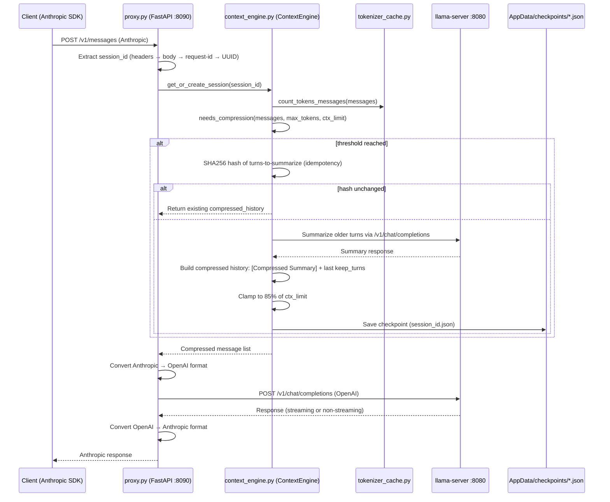

# Context Compression

**Active contributors:** Vijay

Anthropic→OpenAI protocol translation, session summarization, and context budget enforcement via the optional Python Context Manager Proxy (`llo-core/context_manager/`).

## Purpose

The Context Manager Proxy sits between clients and `llama-server`, translating the Anthropic Messages API to OpenAI's Chat Completions API, compressing long conversation histories via summarization, and enforcing a context size limit (`ctx_limit`). It is enabled only when `context_manager.enabled = true` in `llo-config.json` and launched with `script/StartContextManager.ps1` (default proxy port 8090, upstream llama-server on 8080). See [applications/context-manager-proxy.md](../applications/context-manager-proxy.md) for the proxy application page and [overview/architecture.md](../overview/architecture.md) for how the proxy fits into the two-stage pipeline.

## Directory layout

```
llo-core/
└── context_manager/
    ├── proxy.py          # FastAPI server, protocol translation, streaming
    ├── context_engine.py # ContextEngine: compression, token counting, checkpoints
    ├── tokenizer_cache.py# Shared HF tokenizer + alias normalization
    ├── preset_reader.py  # models-preset.ini parser for ctx_limit
    └── config.py         # ContextManagerConfig (Pydantic settings)
script/
└── StartContextManager.ps1  # PowerShell launcher for the proxy
```

## Key Abstractions

| Abstraction | Responsibility | Primary interface |
|-------------|---------------|-------------------|
| `ContextEngine` | Per-session state, token counting, compression heuristic, summarization, disk checkpoints | `llo-core/context_manager/context_engine.py` → `ContextEngine` |
| `SessionState` | `session_id`, `messages`, `summary_block`, `summary_up_to_turn`, `last_compress_hash`, `last_accessed` | `context_engine.py` |
| `needs_compression` | Trigger: `prompt_tokens + max_tokens_requested >= ctx_limit * warn_threshold` | `context_engine.py` |
| Compressed history | `[Compressed History Summary]` system block + last `keep_turns` turns, clamped to 85% of `ctx_limit` | `context_engine.py` → `compress()` |
| Checkpoint | SHA256-keyed session state persisted to AppData for idempotent resume | `context_engine.py` → `_save_checkpoint_to_disk` |
| `ctx_limit` | Context ceiling; `0` = auto-read from `models-preset.ini` via `preset_reader.py` (fallback 65536) | `config.py` / `preset_reader.py` |

## How it works



### Compression trigger (`needs_compression`)

```python
def needs_compression(self, messages, max_tokens_requested, ctx_limit, model_alias=""):
    if ctx_limit <= 0:
        ctx_limit = 65536
    prompt_tokens = self.count_tokens_messages(messages, model_alias)
    total_projected = prompt_tokens + max(0, max_tokens_requested)
    threshold = int(ctx_limit * self.warn_threshold)
    return total_projected >= threshold
```

Defaults: `warn_threshold = 0.70` (trigger at 70% of `ctx_limit`), `keep_turns = 6` recent turns preserved uncompressed, `summary_max_tokens = 768`, `summarize_with_model = "same"`. When `ctx_limit` is `0`, it is read from the active model's `ctx_size` in `models-preset.ini` via `preset_reader.py`, falling back to 65536.

### Compression algorithm

1. **Split** conversation turns: older turns (`delta_turns`) vs the last `keep_turns` turns kept verbatim. Incremental: only turns since `summary_up_to_turn` are re-summarized.
2. **Idempotency check:** SHA256 hash of the session id plus turns-to-summarize; if the hash matches `last_compress_hash`, skip recompression.
3. **Summarize** older turns through `llama-server` (`/v1/chat/completions`) using `summarize_with_model`; merge with any `PRIOR_SUMMARY`.
4. **Rebuild** history: `[Compressed History Summary]` system block + recent window.
5. **Clamp** total tokens to `int(ctx_limit * 0.85)` as a safety margin; tool-call messages are never clamped.
6. **Persist** checkpoint to `%APPDATA%\LLM Manager\checkpoints\{session_id}.json`; reload on `get_or_create_session()`.
7. Background eviction scans sessions every `eviction_interval_sec` (300s) and removes sessions idle beyond `session_ttl_sec` (86400s = 24h).

### Session ID extraction (priority)

1. `x-llm-session-id` header
2. `x-session-id` header
3. `metadata.session_id` in request body
4. `x-request-id` header → `session_{uuid}`
5. Random UUID fallback

### Tokenizer cache (`tokenizer_cache.py`)

Normalizes model aliases to Hugging Face repo IDs (e.g. `claude-3-5-sonnet-20241022` → `anthropic/claude-3.5-sonnet`, `gpt-4o` → `openai/gpt-4o`), checks a persistent file-based cache, downloads from HF Hub on first use (honoring `tokenizer_repo` override), and caches the tokenizer.

## Integration points

- [overview/architecture.md](../overview/architecture.md) — proxy placement between clients and llama-server in the two-stage pipeline.
- [systems/parameter-derivation.md](../systems/parameter-derivation.md) — `models-preset.ini` supplies `ctx_size`, which the proxy resolves as `ctx_limit` via `preset_reader.py`.
- [systems/compatibility-guard.md](../systems/compatibility-guard.md) — not directly involved; the proxy speaks OpenAI to llama-server, so flag compatibility matters only for summarization calls.
- [applications/context-manager-proxy.md](../applications/context-manager-proxy.md) — full proxy application reference (components, config, running, testing).
- [applications/powershell-cli.md](../applications/powershell-cli.md) — `StartContextManager.ps1` launcher and `test-health.ps1` coverage.

## Entry points for modification

| Task | Entry point | File |
|------|-------------|------|
| Change compression trigger threshold | `warn_threshold` / `needs_compression()` | `llo-core/context_manager/context_engine.py` |
| Change turns kept uncompressed | `keep_turns` | `llo-core/context_manager/context_engine.py` |
| Change summary model / max tokens | `summarize_with_model`, `summary_max_tokens` | `context_engine.py` / `config.py` |
| Change checkpoint path or TTL | `_save_checkpoint_to_disk`, eviction loop | `context_engine.py` |
| Change proxy port or upstream URL | `proxy_port`, `llama_server_url` | `config.py` + `StartContextManager.ps1` |
| Add tokenizer alias mapping | Alias normalization table | `llo-core/context_manager/tokenizer_cache.py` |
| Change clamp safety margin (85%) | `_clamp_message_tokens` max_allowed | `context_engine.py` |

## Key source files

| File | Purpose |
|------|---------|
| `llo-core/context_manager/proxy.py` | FastAPI server, Anthropic↔OpenAI translation, SSE streaming |
| `llo-core/context_manager/context_engine.py` | Compression, token counting, checkpoints, eviction |
| `llo-core/context_manager/tokenizer_cache.py` | Shared HF tokenizer, alias normalization, token cache |
| `llo-core/context_manager/preset_reader.py` | `models-preset.ini` parser for `ctx_limit` |
| `llo-core/context_manager/config.py` | `ContextManagerConfig` Pydantic settings |
| `llo-core/context_manager/tests/` | 11 pytest modules |
| `script/StartContextManager.ps1` | PowerShell launcher for the proxy |
| `ui/src-tauri/src/commands/config.rs` | Reads CM config for Claude Code launch port selection |

## Related Pages

- [overview/architecture.md](../overview/architecture.md) — hardware classification, decision flow, core formulas
- [systems/parameter-derivation.md](../systems/parameter-derivation.md) — models-preset.ini generation
- [systems/compatibility-guard.md](../systems/compatibility-guard.md) — llama-server argument compatibility
- [applications/context-manager-proxy.md](../applications/context-manager-proxy.md) — context manager proxy
- [applications/powershell-cli.md](../applications/powershell-cli.md) — PowerShell CLI wizard
