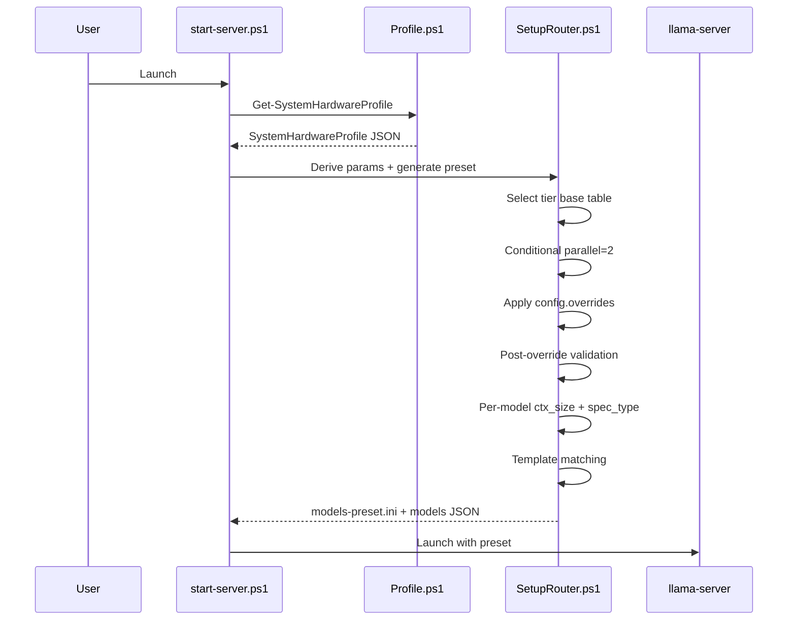

# Hardware-Adaptive Inference

**Active contributors:** vijay

Zero-config llama.cpp parameter derivation from live hardware state.

## Overview

The system profiles hardware at startup, classifies the GPU into a performance tier, and derives every inference parameter automatically. No manual tuning required for typical deployments.

## End-to-end flow



## Tier classification (recap)

| Tier | Condition | Inference Policy |
|------|-----------|------------------|
| `cpu` | No GPU / integrated / no backend / VRAM ≤2 GB | CPU-only, `n_gpu_layers=0`, `flash_attn=off`, `cache_type=f16` |
| `low` | Dedicated, 2–4 GB VRAM | Partial offload, `fit=on target=512`, `cache_type=q8_0`, `spec_type=none` |
| `mid` | Dedicated, 4–8 GB VRAM | Full offload, `fit=on target=1024`, `cache_type=q8_0`, `spec_type=ngram-simple` |
| `high` | Dedicated, >8 GB VRAM | Full offload, `fit=on target=1024`, `cache_type=q8_0/f16`, `spec_type=ngram-simple` |

## Base parameter tables

See [Parameter Derivation](systems/parameter-derivation.md#base-parameter-tables-per-tier) for full tables.

## Key derived parameters

| Parameter | CPU Tier | Low Tier | Mid Tier | High Tier |
|-----------|----------|----------|----------|-----------|
| `n_gpu_layers` | 0 | -1 | -1 | -1 |
| `flash_attn` | off | on | on | on |
| `use_fit` | false | true | true | true |
| `fit_target` | 0 | 512 MB | 1024 MB | 1024 MB |
| `cache_type_k/v` | f16 | q8_0 | q8_0 | q8_0 (f16 if VRAM>12GB) |
| `ubatch_size` | 128 | 256 | 512 | 1024 |
| `parallel` | 1 | 1 | 1/2* | 1/2* |
| `spec_type` | ngram-simple | none | ngram-simple | ngram-simple |

* `parallel=2` when RAM>16GB AND VRAM>4GB (mid/high only)

## Override precedence

```
config.overrides (absolute priority)
    ↓
Hardware-derived (tier base + conditional upgrades)
    ↓
Legacy flat keys (auto-promoted to overrides)
    ↓
Hardcoded defaults
```

## Context size formula (per-model)

```
modelGB = ModelSize_MB / 1024
baseKV = 12.0 × modelGB  (MB per 1K tokens at f16)

kvMBPerKToken = {
    f16:  baseKV × 2.0,
    q8_0: baseKV,
    q4_0: baseKV × 0.5
} × parallel_slots
floored at 5.0 MB

availRAM = BudgetRAM_MB - ModelSize_MB - 512 MB

maxCtxFromRam = floor(availRAM / kvMBPerKToken) × 1000

ctxSize = largest standard size ≤ maxCtxFromRam
Standard sizes: 4096, 8192, 16384, 32768, 65536, 131072, 262144
```

**Integration floors (Claude Code):**
- CPU tier: 32768 minimum
- GPU tiers: 65536 minimum

**User override:** `config.overrides.ctx_size` bypasses formula entirely.

## Speculative decoding

```powershell
# Incompatible architectures → disabled
$incompatible = @("moe", "mixture", "vision", "llava", "clip", 
                  "phi-3-v", "qwen.*vl", "minicpm-v", "cogvlm")

# Low VRAM tier → forced disabled
if ($tier -eq "low") { $spec_type = "none" }

# Otherwise → ngram-simple (~10-15% throughput boost)
```

## VRAM fit-throttle (`--fit`)

Prevents silent VRAM spill (90% throughput drop):
- `low` tier: `--fit --fit-target 512 --fit-ctx-min 4096`
- `mid`/`high`: `--fit --fit-target 1024 --fit-ctx-min 8192`
- `cpu` tier: omitted entirely

Automatically reduces `n_gpu_layers` until model fits in VRAM budget.

## KV cache quantization

| Tier | Flash Attention | K/V Cache | Rationale |
|------|-----------------|-----------|-----------|
| `cpu` | off | f16 | Quantized KV requires Flash Attention |
| `low` | on | q8_0 | Safe quality trade-off |
| `mid` | on | q8_0 | Headroom for longer context |
| `high` | on | q8_0/f16 | f16 when VRAM > 12 GB |

**Validation:** If `flash_attn=off` (override), forces `cache_type_k/v=f16` to prevent crash.

## Thread allocation

```
OptimalThreads = PhysicalCores
capped at 8 for Intel CPUs with >8 physical cores (P-core sweet spot)
floored at 4 minimum
```

## Key source files

| File | Function |
|------|----------|
| `llo-core/Profile.ps1` | `Get-SystemHardwareProfile` |
| `llo-core/SetupRouter.ps1` | `Get-InferenceParams`, `Get-SafeContextSize`, `Get-ValidatedSpecType` |
| `script/start-server.ps1` | Orchestrates profile → router → launch |
| `ui/src-tauri/src/commands/profile.rs` | Tauri bridge |
| `ui/src/lib/validation.ts` | UI exact KV calculator |
