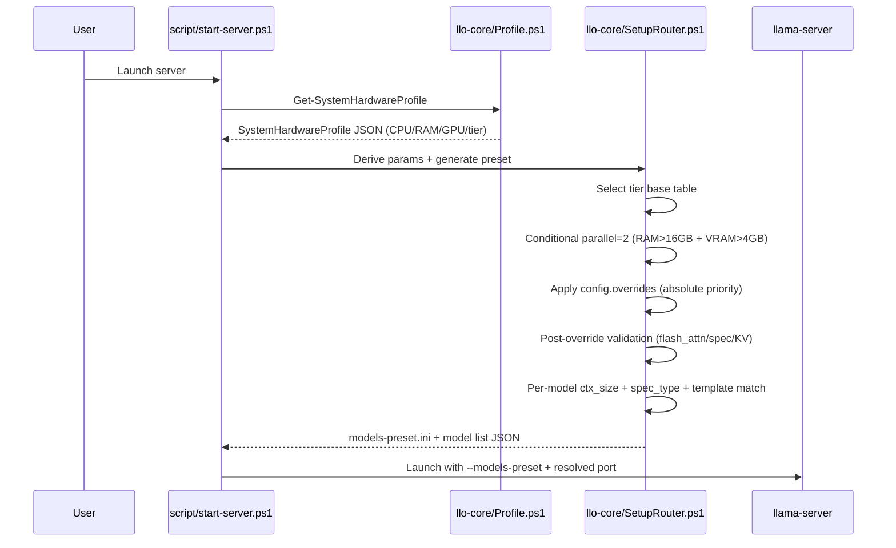

# Hardware-Adaptive Inference

**Active contributors:** Vijay

Zero-config llama.cpp parameter derivation from live hardware state. The system profiles the host, classifies the GPU into a performance tier, and derives every inference flag automatically — no manual tuning required for typical deployments.

## Purpose

Given a `SystemHardwareProfile` from `llo-core/Profile.ps1`, `llo-core/SetupRouter.ps1` selects a base parameter table per `PerformanceTier`, applies conditional upgrades (e.g. `parallel=2`), enforces `config.overrides` with absolute priority, computes a per-model `ctx_size` from available RAM, validates speculative decoding, and writes `models-preset.ini` consumed by `llama-server --models-preset`. See [systems/parameter-derivation.md](../systems/parameter-derivation.md) for the full derivation engine and [overview/architecture.md](../overview/architecture.md) for the hardware classification and decision flow.

## Directory layout

```
llo-core/
├── Profile.ps1      # Get-SystemHardwareProfile (CPU/RAM/GPU, all platforms)
└── SetupRouter.ps1  # Get-InferenceParams, Get-SafeContextSize, Get-ValidatedSpecType, preset writer
script/
└── start-server.ps1 # Orchestrates profile → router → llama-server launch
ui/src/lib/
└── validation.ts    # UI exact KV calculator (bytes/element precision)
```

## Key Abstractions

| Abstraction | Responsibility | Primary interface |
|-------------|---------------|-------------------|
| `SystemHardwareProfile` | Detected CPU/RAM/GPU plus `AdapterClass` (none/integrated/dedicated) and `PerformanceTier` (cpu/low/mid/high) | `llo-core/Profile.ps1` → `Get-SystemHardwareProfile` |
| `PerformanceTier` | Inference policy class driving base table selection | `llo-core/Profile.ps1` |
| `InferenceParams` | Derived llama-server flags (n_gpu_layers, flash_attn, cache type, batch, parallel, spec) | `llo-core/SetupRouter.ps1` → `Get-InferenceParams` |
| `config.overrides` | User values with absolute priority over every derived value | `llo-config.json` |
| `models-preset.ini` | Serialized per-model preset consumed by `llama-server --models-preset` | `llo-core/SetupRouter.ps1` |

## How it works



### Tier classification

| Tier | Condition | Inference policy |
|------|-----------|------------------|
| `cpu` | No GPU, or integrated/shared-memory, or no backend, or VRAM ≤2 GB | CPU-only, `n_gpu_layers=0`, `flash_attn=off`, `cache_type=f16` |
| `low` | Dedicated GPU, 2–4 GB VRAM | Partial offload, `fit=on target=512`, `cache_type=q8_0`, `spec_type=none` |
| `mid` | Dedicated GPU, 4–8 GB VRAM | Full offload, `fit=on target=1024`, `cache_type=q8_0`, `spec_type=ngram-simple` |
| `high` | Dedicated GPU, >8 GB VRAM | Full offload, `fit=on target=1024`, `cache_type=q8_0` (f16 if VRAM>12 GB), `spec_type=ngram-simple` |

Tier boundaries come from `llo-core/Profile.ps1`: dedicated GPUs with VRAM ≤2 GB fall back to the `cpu` tier to avoid slow VRAM spill; integrated GPUs always use the CPU path.

### VRAM budget and fit-throttle

`--fit` prevents silent VRAM spill (a ~90% throughput drop) by automatically reducing `n_gpu_layers` until the model fits the VRAM budget:

| Tier | Fit flags | Rationale |
|------|-----------|-----------|
| `cpu` | omitted entirely | No GPU offload |
| `low` | `--fit --fit-target 512 --fit-ctx-min 4096` | Conservative 512 MB VRAM budget |
| `mid`/`high` | `--fit --fit-target 1024 --fit-ctx-min 8192` | 1024 MB VRAM budget |

`fit-target` values are in MB; `fit-ctx-min` is the context floor the fit logic won't descend below.

### KV cache quantization

| Tier | Flash Attention | K/V cache | Rationale |
|------|-----------------|-----------|-----------|
| `cpu` | off | f16 | Quantized KV requires Flash Attention |
| `low` | on | q8_0 | Safe quality trade-off on small cards |
| `mid` | on | q8_0 | Headroom for longer context |
| `high` | on | q8_0 / f16 | f16 when VRAM > 12 GB |

Validation: if `flash_attn=off` (e.g. via override), `cache_type_k`/`cache_type_v` are forced to `f16` to prevent a crash, since quantized KV caches require Flash Attention.

### Context size formula (per-model)

```
modelGB   = ModelSize_MB / 1024
baseKV    = 12.0 × modelGB            # MB per 1K tokens at f16

kvMBPerKToken = {
    f16:  baseKV × 2.0,
    q8_0: baseKV,
    q4_0: baseKV × 0.5
} × parallel_slots
floored at 5.0 MB

availRAM = BudgetRAM_MB - ModelSize_MB - 512 MB

maxCtxFromRam = floor(availRAM / kvMBPerKToken) × 1000
floored at 4096

ctxSize = largest standard size ≤ maxCtxFromRam
Standard sizes: 4096, 8192, 16384, 32768, 65536, 131072, 262144
```

Integration floors (when the `claude-code` integration is active):
- CPU tier: 32768 minimum
- GPU tiers: 65536 minimum

User override: `config.overrides.ctx_size` bypasses the formula entirely.

Note: the CLI uses a linear KV approximation (`q8_0 = 50% of f16`, `q4_0 = 25%`), while the React diagnostics UI (`ui/src/lib/validation.ts`) uses exact bytes per element (`q8_0 = 53.1%`, `q4_0 = 28.1%`), causing a slight headroom-estimate mismatch between CLI and UI.

### Parallel slots

- Default: `parallel=1`
- Conditional upgrade to `parallel=2` when tier is `mid` or `high` **and** RAM > 16 GB **and** VRAM > 4 GB
- With the `claude-code` integration, `parallel` is floored at 2 to prevent subagent deadlocks

### Speculative decoding

```powershell
# Incompatible architectures → disabled
$incompatible = @("moe", "mixture", "vision", "llava", "clip",
                  "phi-3-v", "qwen.*vl", "minicpm-v", "cogvlm")

# Low VRAM tier → forced disabled
if ($tier -eq "low") { $spec_type = "none" }

# Otherwise → ngram-simple (~10-15% throughput boost)
```

Model aliases matching any incompatible pattern (MoE, mixture-of-experts, vision/LLaVA/CLIP/Phi-3-V/Qwen-VL/MiniCPM-V/CogVLM) get `spec_type=none`.

### Thread allocation

```
OptimalThreads = PhysicalCores
capped at 8 for Intel CPUs with >8 physical cores (P-core sweet spot)
floored at 4 minimum
```

## Integration points

- [overview/architecture.md](../overview/architecture.md) — hardware classification, decision flow, core formulas behind tier selection.
- [systems/parameter-derivation.md](../systems/parameter-derivation.md) — base parameter tables, override application, ctx formula, spec validation, template matching.
- [systems/compatibility-guard.md](../systems/compatibility-guard.md) — derived flags are validated against the `llama-server` binary via `script/verify-scripts.ps1`.
- [applications/context-manager-proxy.md](../applications/context-manager-proxy.md) — the proxy reads `ctx_limit` from `models-preset.ini` via `preset_reader.py`.
- [applications/powershell-cli.md](../applications/powershell-cli.md) — `start-server.ps1` orchestrates profiling, derivation, and launch; exports client env vars.

## Entry points for modification

| Task | Entry point | File |
|------|-------------|------|
| Change GPU tier thresholds (2 GB / 4 GB / 8 GB) | Tier classification `elseif` chain | `llo-core/Profile.ps1` |
| Change base parameter table per tier | `$params = switch ($tier)` block | `llo-core/SetupRouter.ps1` |
| Change conditional parallel=2 rule | RAM>16GB + VRAM>4GB guard | `llo-core/SetupRouter.ps1` |
| Change context size formula or standard sizes | `Get-SafeContextSize` | `llo-core/SetupRouter.ps1` |
| Change speculative decoding incompatible list | `Get-ValidatedSpecType` | `llo-core/SetupRouter.ps1` |
| Change fit target / ctx min per tier | Fit flag construction | `llo-core/SetupRouter.ps1` |
| Change UI KV calculator precision | Exact bytes/element table | `ui/src/lib/validation.ts` |
| Add a user override key | Override application loop | `llo-core/SetupRouter.ps1` |

## Key source files

| File | Purpose |
|------|---------|
| `llo-core/Profile.ps1` | `Get-SystemHardwareProfile` — CPU/RAM/GPU detection + tier classification |
| `llo-core/SetupRouter.ps1` | `Get-InferenceParams`, `Get-SafeContextSize`, `Get-ValidatedSpecType`, preset writer |
| `script/start-server.ps1` | Orchestrates profile → router → `llama-server` launch |
| `ui/src/lib/validation.ts` | UI-side exact KV calculator |
| `ui/src/pages/Performance.tsx` | Override sliders for all derived params |
| `ui/src/pages/Diagnostics.tsx` | Validation display |

## Related Pages

- [overview/architecture.md](../overview/architecture.md) — hardware classification, decision flow, core formulas
- [systems/parameter-derivation.md](../systems/parameter-derivation.md) — models-preset.ini generation
- [systems/compatibility-guard.md](../systems/compatibility-guard.md) — llama-server argument compatibility
- [applications/context-manager-proxy.md](../applications/context-manager-proxy.md) — context manager proxy
- [applications/powershell-cli.md](../applications/powershell-cli.md) — PowerShell CLI wizard
