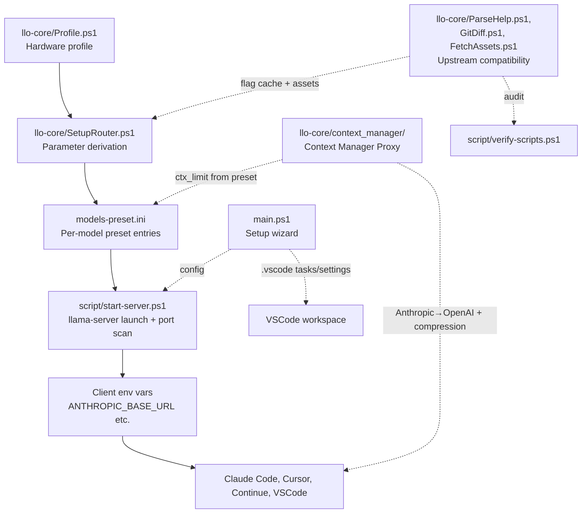

# Features

**Active contributors:** Vijay

Cross-cutting capabilities that span profiling, derivation, routing, compression, integrations, and upstream compatibility.

## Purpose

LLM Manager's features are the user-facing capabilities built on top of the two-stage pipeline (hardware profiling → parameter derivation) described in [overview/architecture.md](../overview/architecture.md). They turn live hardware state into optimal llama-server parameters, route multiple clients to the right model alias, compress long conversations, wire up IDEs and CLI clients, and guard against upstream llama.cpp breaking changes.

Each feature below is backed by one or more systems under `llo-core/` and `script/`, and is exposed through the Tauri desktop app or the PowerShell CLI wizard.

## Feature overview

| Feature | Purpose | Primary systems |
|---------|---------|-----------------|
| [Hardware-Adaptive Inference](hardware-adaptive-inference.md) | Derives all llama-server flags from live hardware: GPU tier, VRAM budget, KV cache quantization, context size, parallel slots, speculative decoding | [systems/parameter-derivation.md](../systems/parameter-derivation.md), [systems/hardware-profiling.md](../systems/hardware-profiling.md) |
| [Dynamic Client Routing](dynamic-client-routing.md) | Scans `models_dir` for GGUF models, writes `models-preset.ini`, clients connect by alias; port collision protection and client env export | [systems/server-lifecycle.md](../systems/server-lifecycle.md) |
| [Context Compression](context-compression.md) | Optional Python proxy translating Anthropic→OpenAI, summarizing history under a `ctx_limit` with checkpoints | [applications/context-manager-proxy.md](../applications/context-manager-proxy.md) |
| [Client Integrations](client-integrations.md) | Wizard-generated `.vscode/tasks.json`/`.vscode/settings.json`, Claude Code CLI env, Cursor and Continue configs | [applications/powershell-cli.md](../applications/powershell-cli.md) |
| [Upstream Compatibility](upstream-compatibility.md) | `llama-server --help` two-pass parsing, git change detection, SHA-cached template/grammar sync | [systems/compatibility-guard.md](../systems/compatibility-guard.md) |

## How the features fit together



## Directory layout

```
droid-wiki/features/
├── index.md                    # This index: lists the five features
├── hardware-adaptive-inference.md   # Tier-based parameter derivation
├── dynamic-client-routing.md        # models-preset.ini + client alias routing
├── context-compression.md           # Python context manager proxy
├── client-integrations.md           # VSCode, Claude Code, Cursor, Continue
└── upstream-compatibility.md        # Flag parser, git scanner, asset sync
```

## Key Abstractions

| Abstraction | Responsibility | Defined in |
|-------------|---------------|------------|
| `SystemHardwareProfile` | Detected CPU/RAM/GPU plus `AdapterClass` and `PerformanceTier` | `llo-core/Profile.ps1` |
| `PerformanceTier` | Inference policy class: `cpu`, `low`, `mid`, `high` | `llo-core/Profile.ps1` |
| `InferenceParams` | Tier-based llama-server flags (layers, flash-attn, KV type, batch, parallel, spec) | `llo-core/SetupRouter.ps1` |
| `config.overrides` | User-supplied values with absolute priority over hardware-derived params | `llo-config.json` |
| `models-preset.ini` | Serialized per-model preset consumed by `llama-server --models-preset` | `llo-core/SetupRouter.ps1` |
| `SessionState` / `ContextEngine` | Per-session compression state and needs_compression heuristic | `llo-core/context_manager/context_engine.py` |
| `FlagCache` | Cached `llama-server --help` flags for compatibility auditing | `llo-core/ParseHelp.ps1` |

## Integration points

- [overview/architecture.md](../overview/architecture.md) — hardware classification, decision flow, core formulas shared by every feature.
- [systems/parameter-derivation.md](../systems/parameter-derivation.md) — `models-preset.ini` generation that Hardware-Adaptive Inference and Dynamic Client Routing both depend on.
- [systems/compatibility-guard.md](../systems/compatibility-guard.md) — llama-server argument compatibility that Upstream Compatibility enforces before derived params reach the server.
- [applications/context-manager-proxy.md](../applications/context-manager-proxy.md) — the context manager proxy that implements Context Compression.
- [applications/powershell-cli.md](../applications/powershell-cli.md) — the PowerShell CLI wizard that implements Client Integrations and server lifecycle.

## Entry points for modification

| Task | Entry point | File |
|------|-------------|------|
| Change GPU tier thresholds or VRAM boundaries | Tier classification logic | `llo-core/Profile.ps1` |
| Change base parameter table per tier | Tier `switch` block | `llo-core/SetupRouter.ps1` |
| Change context size formula or standard sizes | `Get-SafeContextSize` | `llo-core/SetupRouter.ps1` |
| Change speculative decoding allow-list | `Get-ValidatedSpecType` | `llo-core/SetupRouter.ps1` |
| Change compression trigger threshold or keep_turns | `needs_compression` / `compress` | `llo-core/context_manager/context_engine.py` |
| Change proxy port or env var export | Server launch + env block | `script/start-server.ps1` |
| Change wizard-generated VSCode files | VSCode tasks/settings writer | `main.ps1` |
| Change excluded non-llama-server flags | Exclusion list | `script/verify-exclude.json` |

## Key source files

| File | Purpose |
|------|---------|
| `main.ps1` | Setup wizard; generates `.vscode/tasks.json` and `.vscode/settings.json` |
| `llo-core/Profile.ps1` | Cross-platform hardware profiler (`Get-SystemHardwareProfile`) |
| `llo-core/SetupRouter.ps1` | Tier-based parameter derivation and preset writer |
| `llo-core/context_manager/context_engine.py` | Compression engine, token counting, checkpoints |
| `llo-core/context_manager/proxy.py` | FastAPI proxy, Anthropic↔OpenAI translation |
| `script/start-server.ps1` | Server launch, port collision protection, env export |
| `script/verify-scripts.ps1` | Flag compatibility audit against `llama-server` binary |
| `llo-core/ParseHelp.ps1` | `llama-server --help` two-pass parser |
| `llo-core/GitDiff.ps1` | Upstream git change detector |
| `llo-core/FetchAssets.ps1` | SHA-cached template/grammar sync |

## Related Pages

- [overview/architecture.md](../overview/architecture.md) — hardware classification, decision flow, core formulas
- [systems/parameter-derivation.md](../systems/parameter-derivation.md) — models-preset.ini generation
- [systems/compatibility-guard.md](../systems/compatibility-guard.md) — llama-server argument compatibility
- [applications/context-manager-proxy.md](../applications/context-manager-proxy.md) — context manager proxy
- [applications/powershell-cli.md](../applications/powershell-cli.md) — PowerShell CLI wizard
