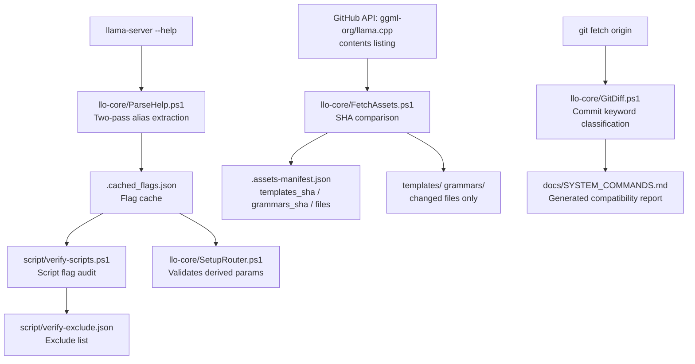

# Upstream Compatibility

**Active contributors:** Vijay

Proactive protection against upstream `llama.cpp` (ggml-org/llama.cpp) breaking changes through flag parsing, git change detection, and SHA-cached asset synchronization.

## Purpose

Three components guard LLM Manager against `llama-server` changes that could break derived parameters or missing templates: `llo-core/ParseHelp.ps1` parses `llama-server --help` with a two-pass algorithm and caches flags; `llo-core/GitDiff.ps1` scans upstream commits for hardware-impacting changes; `llo-core/FetchAssets.ps1` keeps chat templates and grammars in sync via SHA comparison. `script/verify-scripts.ps1` audits all PowerShell scripts against the compiled binary, using `script/verify-exclude.json` for non-llama-server flags. See [systems/compatibility-guard.md](../systems/compatibility-guard.md) for the guard system page and [overview/architecture.md](../overview/architecture.md) for where compatibility fits in the pipeline.

## Directory layout

```
llo-core/
├── ParseHelp.ps1     # Get-LlamaServerFlags, two-pass parsing, Update-CachedFlags
├── GitDiff.ps1       # Get-LlamaGitStatus, commit impact classification
└── FetchAssets.ps1   # Sync-LlamaAssets, SHA-cached template/grammar download
script/
├── verify-scripts.ps1  # Flag compatibility audit vs llama-server binary
└── verify-exclude.json # Exclude list for non-llama-server flags (dynamically loaded)
.assets-manifest.json   # Template/grammar SHA manifest (repo root)
.cached_flags.json      # Flag cache (repo root / AppData)
```

## Key Abstractions

| Abstraction | Responsibility | Primary interface |
|-------------|---------------|-------------------|
| Flag entry | `Short`, `Long`, `Aliases`, `ValueToken`, `Description`, `EnvVar` per `llama-server --help` line | `llo-core/ParseHelp.ps1` |
| Flag cache diff | `Added` / `Removed` / `TotalCurrent` from `Update-CachedFlags` | `llo-core/ParseHelp.ps1`, `.cached_flags.json` |
| Commit impact tag | Classified commit impact (CUDA/GPU, CPU, Performance, Breaking Change, Server/API, Flash Attention) | `llo-core/GitDiff.ps1` |
| Asset manifest | `templates_sha`, `grammars_sha`, per-file SHA map for changed-file-only downloads | `.assets-manifest.json` |
| Exclude list | Non-llama-server `--flags` skipped during script audit | `script/verify-exclude.json` |

## How it works



### Layer 1: Flag parser (`ParseHelp.ps1`)

**Two-pass parsing:**
1. **Pass 1:** Match help lines starting with flag tokens (`$optionLineRegex = '^\s{0,12}((?:-[\w?]+,\s+)?(?:--[\w-]+(?:,\s+)?)+)'`)
2. **Pass 2:** Extract **all** long aliases from the line (`--[\w-]+`), e.g. `-ngl, --gpu-layers, --n-gpu-layers N` → `["--gpu-layers", "--n-gpu-layers"]`

Each alias is registered individually for allow-list lookup.

**Flag entry structure:**
```powershell
[pscustomobject]@{
    Short       = $shortAlias      # e.g., "-ngl"
    Long        = $primaryLong     # e.g., "--n-gpu-layers"
    Aliases     = $longAliases     # All aliases from the line
    ValueToken  = $valueToken      # e.g., "N", "PATH", "BOOL"
    Description = $desc            # Help text
    EnvVar      = $envVar          # From "(env: VAR_NAME)"
}
```

**Cache update (`Update-CachedFlags`):** compares current binary flags against `.cached_flags.json`, reports `Added`/`Removed` flags, then rewrites the cache with `ConvertTo-Json -Depth 5`.

Example output:
```
--- Help Parser Diff Results ---
Total flags in current binary: 142
New flags added: 3
  + --new-flag (New feature description)
  + --another-flag (Another description)
Deprecated/removed flags: 1
  - --old-flag (Deprecated description)
--------------------------------
```

### Layer 2: Git change detector (`GitDiff.ps1`)

**Status check:**
```powershell
git fetch origin
git rev-list --left-right --count HEAD...@{u}
# Returns: "ahead_count behind_count"
```

**Commit impact classification** — scans recent commits (`HEAD~15..HEAD`, or `ORIG_HEAD..HEAD` after pull) for keywords:

| Keyword pattern | Impact tag |
|-----------------|------------|
| `cuda\|nvidia\|gpu\|vram` | CUDA/GPU |
| `cpu\|thread\|numa` | CPU |
| `perf\|speed\|token/s\|throughput` | Performance |
| `breaking\|deprecate\|remove` | Breaking Change |
| `server\|preset\|api` | Server/API |
| `flash-attn\|flashattn` | Flash Attention |

### Layer 3: Script audit (`verify-scripts.ps1`)

1. Runs `llama-server --help` via `ParseHelp.ps1` to build the allowed flag list
2. Scans all `script/*.ps1` files for `--flag` usage
3. Reports any script flag missing from the binary help as incompatible
4. Generates `docs/SYSTEM_COMMANDS.md` with hardware profile, git status, and the full options registry

**Exclude handling:** `verify-scripts.ps1` dynamically loads `script/verify-exclude.json` when present (candidate path `script/verify-exclude.json`); otherwise falls back to built-in defaults (`--query-gpu`, `--format`, `--oneline`, `--no-merges`, `--show-current`, `--pretty`, `--abbrev-commit`, `--since`, `--follow`, `--nounits`, `--csv`, `--noheader`, `--quiet`, `--directory`, `--host`, `--port`, `--python`, `--help`, `--version`, `--verbose`, `--debug`, `--dry-run`, `---`).

### Layer 3 (assets): SHA-cached sync (`FetchAssets.ps1`)

```powershell
# Conceptual flow
$manifest = Get-Content .assets-manifest.json | ConvertFrom-Json
$remoteTemplates = Invoke-RestMethod "https://api.github.com/repos/ggml-org/llama.cpp/contents/models/templates"
$remoteGrammars  = Invoke-RestMethod "https://api.github.com/repos/ggml-org/llama.cpp/contents/grammars"
# Compare SHA; download changed files only; update manifest
```

**Manifest structure (`.assets-manifest.json`):**
```json
{
  "templates_sha": "abc123...",
  "grammars_sha": "def456...",
  "files": {
    "llama.jinja": "sha1...",
    "chatml.jinja": "sha2...",
    "json.gbnf": "sha3..."
  }
}
```

**Offline fallback:** if the GitHub API is unreachable and no local templates exist, the wizard prompts the user to apply bundled `templates/default.jinja` to all models and sets `use_default_template = true` in config.

## Integration points

- [overview/architecture.md](../overview/architecture.md) — compatibility guard as a pre-flight check before derived parameters reach the server.
- [systems/parameter-derivation.md](../systems/parameter-derivation.md) — `SetupRouter.ps1` uses cached flags to validate derived params; template matching uses synced `templates/`.
- [systems/compatibility-guard.md](../systems/compatibility-guard.md) — guard system overview (this feature's implementation detail).
- [applications/context-manager-proxy.md](../applications/context-manager-proxy.md) — not directly involved; proxy speaks OpenAI to llama-server.
- [applications/powershell-cli.md](../applications/powershell-cli.md) — `main.ps1` wizard runs `FetchAssets.ps1` and `ParseHelp.ps1` during setup; `test-health.ps1` runs both inline.

## Entry points for modification

| Task | Entry point | File |
|------|-------------|------|
| Change flag parsing regexes | Pass 1 line match / Pass 2 alias extraction | `llo-core/ParseHelp.ps1` |
| Change cache file location or diff logic | `Update-CachedFlags` | `llo-core/ParseHelp.ps1` |
| Add a commit impact keyword | Keyword pattern → impact tag table | `llo-core/GitDiff.ps1` |
| Add an excluded non-llama-server flag | Exclusion list (loaded when file present) | `script/verify-exclude.json` |
| Change asset sources (templates/grammars paths) | GitHub API URLs in `Sync-LlamaAssets` | `llo-core/FetchAssets.ps1` |
| Change offline fallback template | Bundled default template application | `llo-core/FetchAssets.ps1` |

## Key source files

| File | Purpose |
|------|---------|
| `llo-core/ParseHelp.ps1` | `Get-LlamaServerFlags`, `Update-CachedFlags` |
| `llo-core/GitDiff.ps1` | `Get-LlamaGitStatus`, commit impact classification |
| `llo-core/FetchAssets.ps1` | `Sync-LlamaAssets`, SHA-cached download |
| `script/verify-scripts.ps1` | Flag compatibility vs binary; generates `docs/SYSTEM_COMMANDS.md` |
| `script/test-health.ps1` | Integrated flag check during health audit |
| `script/verify-exclude.json` | Exclude list for non-llama-server flags |
| `.cached_flags.json` | Flag cache (repo root / AppData) |
| `.assets-manifest.json` | Template/grammar SHA manifest |
| `docs/SYSTEM_COMMANDS.md` | Generated compatibility report |

## Related Pages

- [overview/architecture.md](../overview/architecture.md) — hardware classification, decision flow, core formulas
- [systems/parameter-derivation.md](../systems/parameter-derivation.md) — models-preset.ini generation
- [systems/compatibility-guard.md](../systems/compatibility-guard.md) — llama-server argument compatibility
- [applications/context-manager-proxy.md](../applications/context-manager-proxy.md) — context manager proxy
- [applications/powershell-cli.md](../applications/powershell-cli.md) — PowerShell CLI wizard
