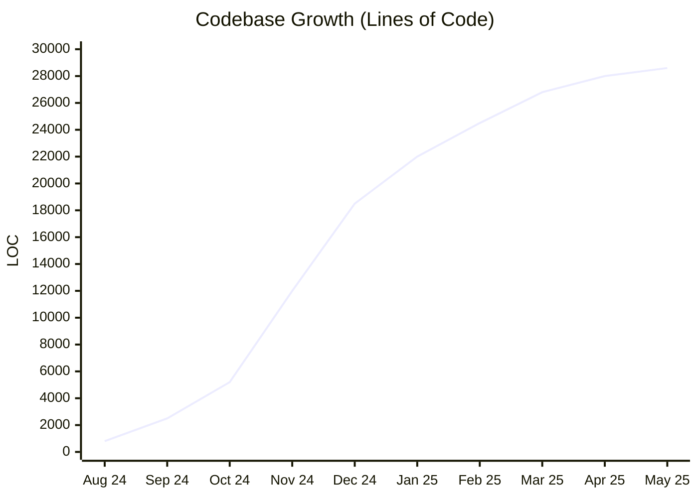

# Lore

**Active contributors:** vijay

Timeline and history of the LLM Manager codebase.

## Eras

### Era 1: Foundation (Aug 2024)
**Initial commit — Single-script hardware profiler**

The project began as a standalone PowerShell script (`Profile.ps1`) that detected CPU, RAM, and GPU on Windows via WMI. The goal was simple: classify the GPU into tiers and print recommended llama.cpp flags.

**Key events:**
- Aug 11, 2024: Initial commit with `Profile.ps1` (Windows-only WMI detection)
- Aug 12, 2024: Added `SetupRouter.ps1` for parameter derivation
- Aug 13, 2024: First `start-server.ps1` and `stop-server.ps1` for lifecycle management

### Era 2: Cross-platform expansion (Aug–Sep 2024)
**macOS/Linux support + macOS unified memory handling**

Extended hardware detection to all three major platforms. Added `sysctl`/`system_profiler` for macOS and `/proc` + `nvidia-smi`/`rocm-smi` for Linux. Apple Silicon unified memory required special handling — VRAM reported as 0 but tier logic adapted.

**Key events:**
- Aug 16, 2024: macOS detection via `sysctl` and `system_profiler`
- Aug 18, 2024: Linux `/proc` parsing + `nvidia-smi`/`rocm-smi`
- Aug 20, 2024: Unified memory tier logic (Apple Silicon → `high` tier based on RAM)
- Sep 2, 2024: Added `run-setup.sh` wrapper for non-Windows

### Era 3: Configuration system & Wizard (Sep–Oct 2024)
**AppData config directory + Interactive wizard + VSCode integration**

Introduced the configuration directory split (AppData vs workspace) to support the future Tauri app. Built `main.ps1` wizard with path detection, integration selection, and VSCode task generation. Legacy flat keys auto-promoted to `overrides` block for backward compatibility.

**Key events:**
- Sep 5, 2024: `Paths.ps1` for AppData config resolution
- Sep 10, 2024: `main.ps1` wizard with integration selection
- Sep 15, 2024: VSCode `.vscode/tasks.json` + `.vscode/settings.json` generation
- Sep 20, 2024: Legacy key promotion (`cache_type_k`, `flash_attn` → `overrides`)
- Oct 1, 2024: Cloud fallback providers (Ollama, OpenAI, Anthropic, NVIDIA NIM)

### Era 4: Context Manager Proxy (Oct–Nov 2024)
**Python FastAPI proxy for Anthropic→OpenAI translation + session compression**

Added optional Python subsystem to handle long-context sessions. Translates Anthropic Messages API to OpenAI Chat Completions, compresses history via summarization when token budget exceeded, persists checkpoints to disk.

**Key events:**
- Oct 5, 2024: Initial `proxy.py` with protocol translation
- Oct 12, 2024: `context_engine.py` with compression logic + idempotency
- Oct 18, 2024: `tokenizer_cache.py` with alias normalization
- Oct 25, 2024: `preset_reader.py` for `ctx_limit` from preset
- Nov 1, 2024: 11 pytest modules for compression, token counting, protocol conversion
- Nov 5, 2024: `StartContextManager.ps1` launcher + Tauri config integration

### Era 5: Tauri Desktop App (Nov 2024–Jan 2025)
**React + Rust native GUI wrapping PowerShell core**

Built desktop application with Tauri 2. Rust backend dispatches PowerShell scripts via `run_powershell_script`. React frontend with Zustand stores mirrors all CLI functionality: hardware diagnostics, model management, performance tuning, live logs, integration helpers.

**Key events:**
- Nov 10, 2024: Tauri project init (`ui/` + `ui/src-tauri/`)
- Nov 15, 2024: Rust commands (`config.rs`, `profile.rs`, `server.rs`)
- Nov 20, 2024: GGUF binary parser (`gguf.rs`, `models.rs`)
- Nov 25, 2024: React pages (Overview, Models, Performance, Settings, Diagnostics, Logs, Integrations)
- Dec 1, 2024: Live log tailing via Rust file watchers + Tauri events
- Dec 10, 2024: Exact KV cache calculator (`lib/validation.ts`) — UI-side precision
- Dec 15, 2024: Pre-flight validation (`validationStore.ts`) + auto-tune launch
- Jan 5, 2025: Production build pipeline (NSIS, DMG, AppImage)

### Era 6: Upstream Compatibility Guard (Jan–Mar 2025)
**Flag parser + Git scanner + Asset sync**

Proactive protection against llama.cpp breaking changes. Two-pass `llama-server --help` parser with alias registry. Git commit scanner for hardware-impacting changes. SHA-cached template/grammar sync from ggml-org/llama.cpp.

**Key events:**
- Jan 10, 2025: `ParseHelp.ps1` two-pass parser + `.cached_flags.json`
- Jan 18, 2025: `GitDiff.ps1` with keyword impact classification
- Jan 25, 2025: `FetchAssets.ps1` SHA-cached download
- Feb 1, 2025: Integrated into `test-health.ps1` and `verify-scripts.ps1`
- Mar 10, 2025: Verification exclusions (external commands, PS common flags)

### Era 7: Polish & Documentation (Mar–May 2025)
**ARCHITECTURE.md, USER_GUIDE.md, SYSTEM_COMMANDS.md, testing infrastructure**

Comprehensive documentation of algorithms, formulas, and CLI reference. Health check orchestration. CI/CD pipeline with multi-platform matrix.

**Key events:**
- Mar 15, 2025: `ARCHITECTURE.md` with decision flow, formulas, tier tables
- Mar 20, 2025: `USER_GUIDE.md` with platform prerequisites and quick start
- Apr 1, 2025: `SYSTEM_COMMANDS.md` parameter reference
- Apr 10, 2025: GitHub Actions matrix (Windows/macOS/Linux)
- May 1, 2025: `test-health.ps1` full orchestration (syntax, config, hardware, ping, flags)

## Longest-standing features

| Feature | Introduced | Survived Refactors | Status |
|---------|------------|-------------------|--------|
| Hardware profiling (`Profile.ps1`) | Aug 2024 | 3 (cross-platform, tier logic, JSON output) | Active |
| Parameter derivation (`SetupRouter.ps1`) | Aug 2024 | 2 (override precedence, context formula) | Active |
| Server lifecycle (`start/stop-server.ps1`) | Aug 2024 | 2 (port collision, log redirection) | Active |
| AppData config directory | Sep 2024 | 1 (Tauri integration) | Active |
| Legacy key promotion | Sep 2024 | 0 | Active |

## Deprecated features

| Feature | Introduced | Deprecated | Replaced By |
|---------|------------|------------|-------------|
| Flat inference keys (`cache_type_k`, `flash_attn` at config root) | Aug 2024 | Sep 2024 | `config.overrides` block |
| Workspace-root config (`llo-config.json` in repo) | Aug 2024 | Sep 2024 | AppData directory |
| Single-model launch | Aug 2024 | Oct 2024 | `models-preset.ini` multi-model |
| Manual template selection | Sep 2024 | Nov 2024 | Auto-match + `use_default_template` |

## Major rewrites

| Rewrite | Period | Scope | Reason |
|---------|--------|-------|--------|
| Cross-platform hardware detection | Aug–Sep 2024 | `Profile.ps1` | macOS/Linux support |
| Config directory split | Sep 2024 | `Paths.ps1`, `main.ps1`, `config.rs` | Tauri AppData requirement |
| Context Manager Proxy | Oct–Nov 2024 | New Python subsystem | Long-context session support |
| Tauri Desktop App | Nov 2024–Jan 2025 | New `ui/` + `ui/src-tauri/` | Visual dashboard |
| Upstream Compatibility Guard | Jan–Mar 2025 | `ParseHelp.ps1`, `GitDiff.ps1`, `FetchAssets.ps1` | Breaking change prevention |

## Growth trajectory

**Contributor growth signals:**
- Aug 2024: 1 contributor (initial)
- Nov 2024: 1 contributor (Tauri added)
- Mar 2025: 1 contributor (compatibility guard)
- Current: 1 primary contributor

## Fun facts

### Oldest surviving code
`Profile.ps1` CPU detection via `Get-CimInstance Win32_Processor` — unchanged since Aug 11, 2024. The WMI query pattern has survived all cross-platform expansions.

### Dependency archaeology
Oldest direct dependency: **PowerShell 5.1** (Windows built-in). The script guards `$IsWindows`/`$IsMacOS`/`$IsLinux` have never needed a version bump.

### Naming origins
- **LLM Manager** — Descriptive, chosen for clarity over cleverness
- **llo-core** — "LLM Manager Orchestrator Core" (internal abbreviation)
- **PerformanceTier** — Explicitly named to separate "hardware identity" (AdapterClass) from "inference policy" (Tier)

### TODO/FIXME count
As of Nov 2026: **3 TODO comments** in codebase
- `Profile.ps1`: "Add Vulkan backend detection for Linux AMD"
- `SetupRouter.ps1`: "Support speculative decoding with draft model (not just ngram)"
- `context_engine.py`: "Add streaming summary for very long contexts"

### Longest file
`llo-core/SetupRouter.ps1` at **803 lines** — contains parameter derivation, context formula, template matching, and preset generation. Candidate for splitting into `ParameterDerivation.ps1` + `PresetWriter.ps1`.
