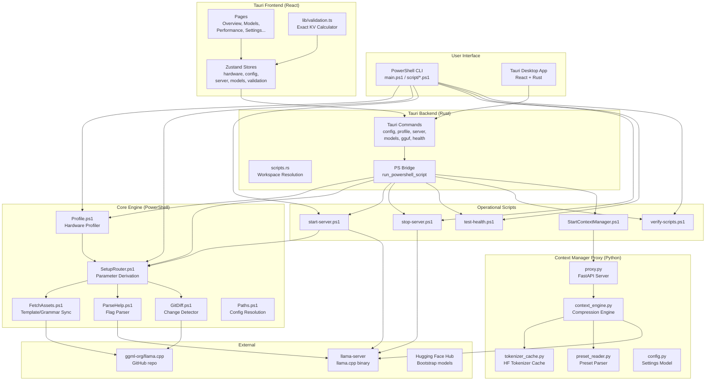
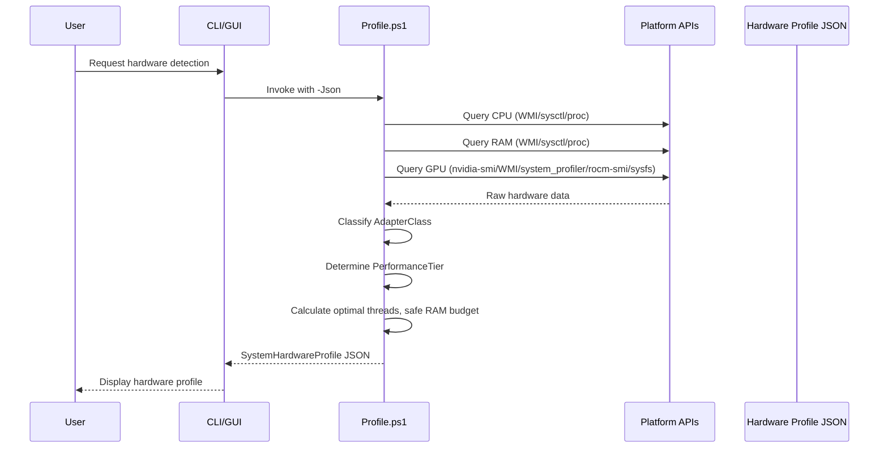
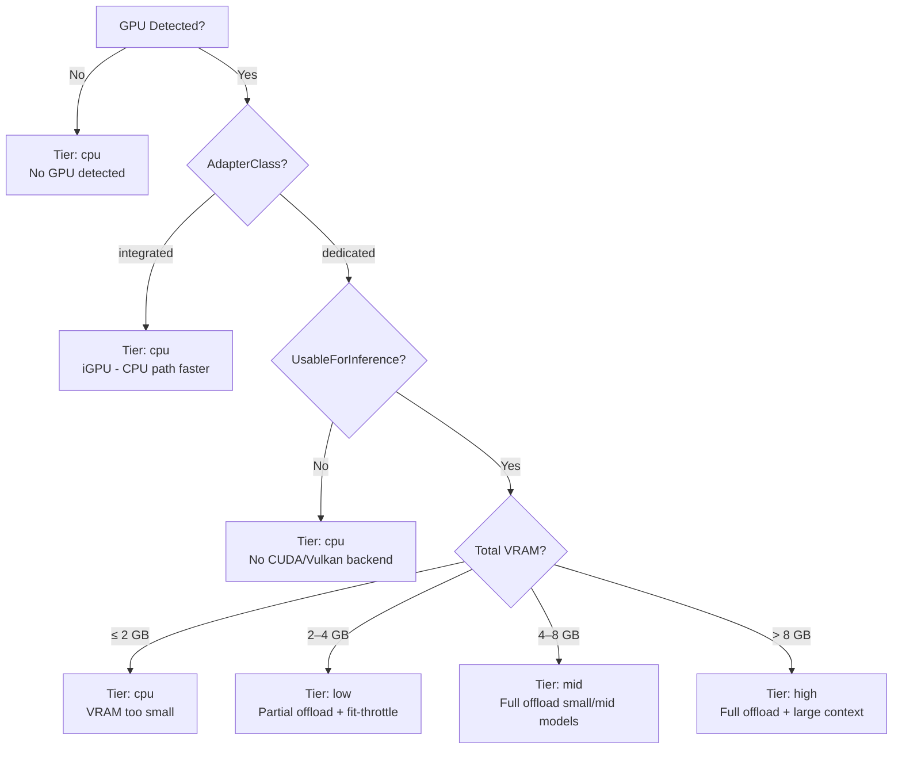
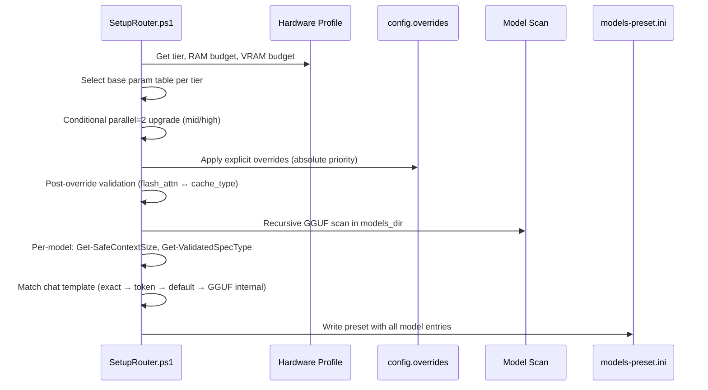
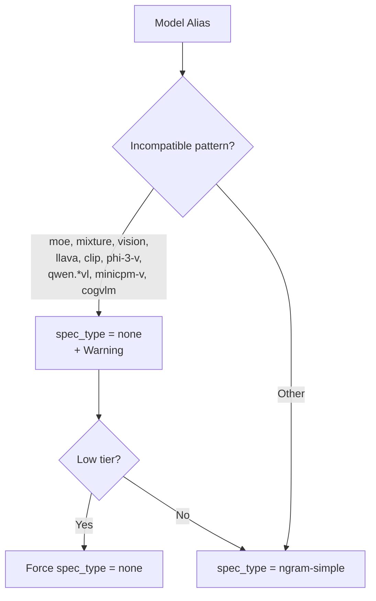
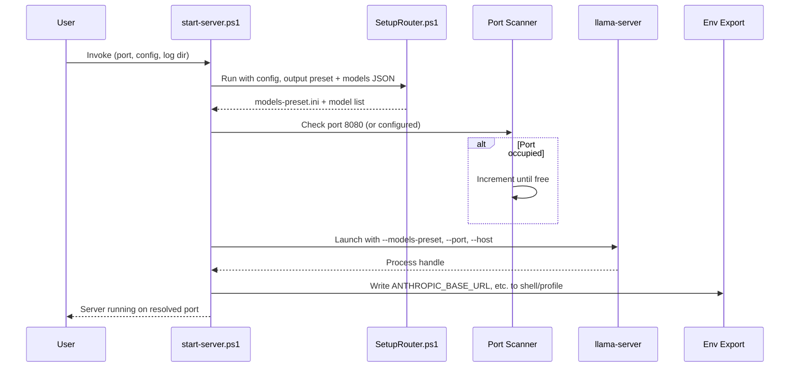
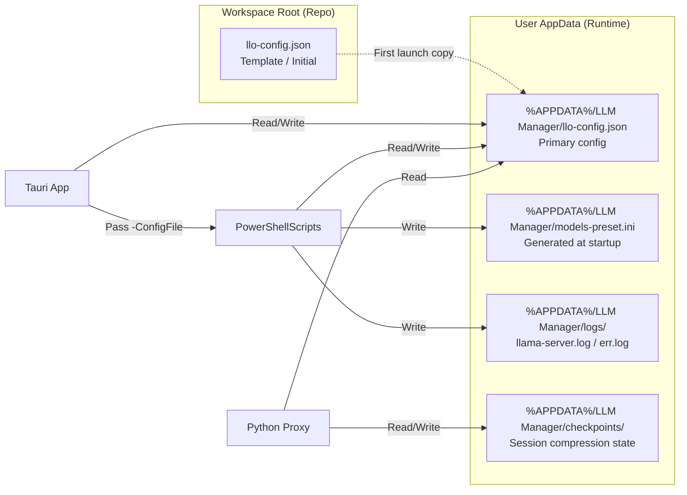
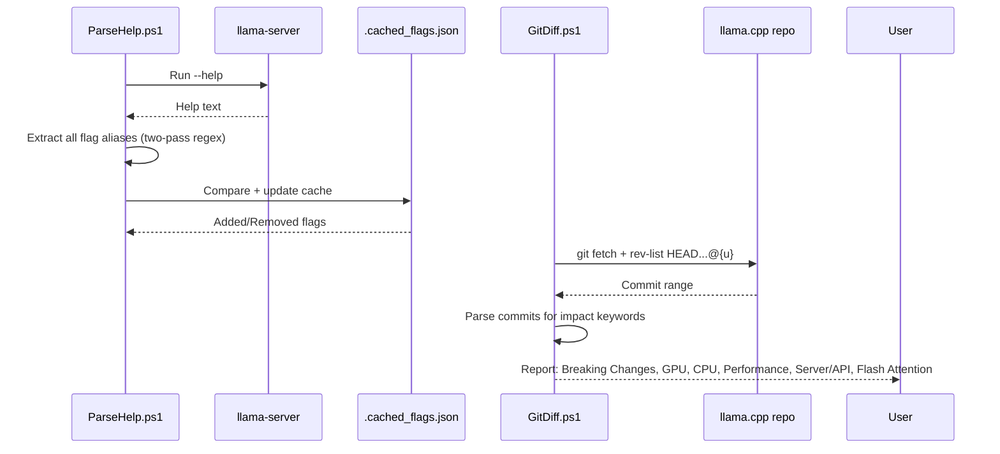

# Architecture

**Active contributors:** vijay

This page documents the system architecture, data flows, and core algorithms of LLM Manager.

## Component diagram



## Hardware profiling pipeline



## AdapterClass classification

| Value | Conditions |
|-------|------------|
| `none` | No GPU detected |
| `integrated` | Intel UHD/Iris/HD, AMD Radeon (non-RX), or `AdapterRAM ≈ TotalPhysicalMemory` |
| `dedicated` | Discrete GPU with confirmed onboard VRAM (nvidia-smi or WMI non-shared) |

**Detection priority:**
1. `nvidia-smi` — preferred for NVIDIA, picks GPU with most free VRAM
2. WMI `Win32_VideoController` — Windows fallback, filters shared-memory adapters
3. `system_profiler SPDisplaysDataType` — macOS, detects Apple Silicon and discrete GPUs
4. `rocm-smi` — Linux AMD GPUs via ROCm
5. `/sys/class/drm` sysfs — Linux fallback, reads `mem_info_vram_total`

## PerformanceTier classification



| Tier | VRAM Range | Reason Printed |
|------|------------|----------------|
| `cpu` | No GPU / integrated / no backend / ≤2 GB | "No GPU detected / Integrated GPU / No compatible backend / VRAM below 2 GB threshold" |
| `low` | 2049–4096 MB | "Dedicated GPU ~X GB VRAM - partial offload with fit-throttle" |
| `mid` | 4097–8192 MB | "Dedicated GPU ~X GB VRAM - full offload for small-mid models" |
| `high` | > 8192 MB | "Dedicated GPU ~X GB VRAM - full offload, large context available" |

## Parameter derivation flow



## Base parameter tables per tier

| Parameter | cpu | low | mid | high |
|-----------|-----|-----|-----|------|
| `n_gpu_layers` | 0 | -1 | -1 | -1 |
| `flash_attn` | off | on | on | on |
| `use_fit` | false | true | true | true |
| `fit_target` | 0 | 512 MB | 1024 MB | 1024 MB |
| `fit_ctx_min` | 0 | 4096 | 8192 | 8192 |
| `cache_type_k` | f16 | q8_0 | q8_0 | q8_0 / f16* |
| `cache_type_v` | f16 | q8_0 | q8_0 | q8_0 / f16* |
| `ubatch_size` | 128 | 256 | 512 | 1024 |
| `parallel` | 1 | 1 | 1 / 2† | 1 / 2† |
| `spec_type` | ngram-simple | none | ngram-simple | ngram-simple |
| `context_shift` | true | true | true | true |
| `cache_reuse` | 0 | 256 | 256 | 256 |
| `mmap` | 1 | 1 | 1 | 1 |

* `f16` when VRAM > 12 GB, otherwise `q8_0`
† Upgraded to 2 when RAM > 16 GB AND VRAM > 4 GB

## Context size formula (per-model)

```
modelGB = ModelSize_MB / 1024.0
baseKV = 12.0 × modelGB           (MB per 1K tokens at f16)

kvMBPerKToken = {
    f16:  baseKV × 2.0,
    q8_0: baseKV,
    q4_0: baseKV × 0.5
} × parallel_slots
floored at 5.0 MB minimum

availRAM = BudgetRAM_MB - ModelSize_MB - 512 MB (headroom)

maxCtxFromRam = floor(availRAM / kvMBPerKToken) × 1000

ctxSize = largest of {4096, 8192, 16384, 32768, 65536, 131072, 262144} ≤ maxCtxFromRam
```

**Integration-aware floors:**
- CPU tier + Claude Code: floor 32768
- GPU tiers + Claude Code: floor 65536

**CLI vs UI discrepancy:** CLI uses 50%/25% ratios for q8_0/q4_0 vs f16. UI (`lib/validation.ts`) uses exact byte sizes: f16=2.0, q8_0=1.0625, q4_0=0.5625 bytes/element → q8_0 is 53.1% of f16, q4_0 is 28.1%.

## Speculative decoding validation



## Server startup sequence



## Configuration directory split



## Upstream compatibility guard



## Key source files

| File | Purpose |
|------|---------|
| `llo-core/Profile.ps1` | Hardware profiler — CPU/RAM/GPU detection for all platforms |
| `llo-core/SetupRouter.ps1` | Parameter derivation + `models-preset.ini` generator |
| `llo-core/ParseHelp.ps1` | llama-server `--help` parser for upstream compatibility |
| `llo-core/GitDiff.ps1` | Upstream git change detector with impact classification |
| `llo-core/FetchAssets.ps1` | SHA-cached template/grammar downloader from llama.cpp |
| `llo-core/Paths.ps1` | Config path resolution (AppData vs workspace) |
| `script/start-server.ps1` | Server lifecycle: terminate old, run SetupRouter, launch |
| `script/stop-server.ps1` | Graceful shutdown across platforms |
| `script/test-health.ps1` | End-to-end health checks (syntax, config, hardware, ping) |
| `script/verify-scripts.ps1` | Flag compatibility vs current llama-server binary |
| `ui/src-tauri/src/commands/profile.rs` | Tauri command: hardware detection bridge |
| `ui/src-tauri/src/commands/server.rs` | Tauri command: start/stop, log tailing |
| `ui/src-tauri/src/commands/models.rs` | Tauri command: GGUF scanner + binary parser |
| `ui/src-tauri/src/commands/gguf.rs` | GGUF binary header metadata extraction |
| `ui/src-tauri/src/commands/config.rs` | Tauri command: config load/save (AppData) |
| `ui/src-tauri/src/scripts.rs` | Workspace root resolution, PS dispatch |
| `llo-core/context_manager/proxy.py` | FastAPI proxy, Anthropic→OpenAI translation |
| `llo-core/context_manager/context_engine.py` | Compression, token counting, checkpoints |
| `llo-core/context_manager/tokenizer_cache.py` | Shared HF tokenizer with alias normalization |
| `ui/src/lib/validation.ts` | Exact KV cache calculator (UI diagnostics) |
