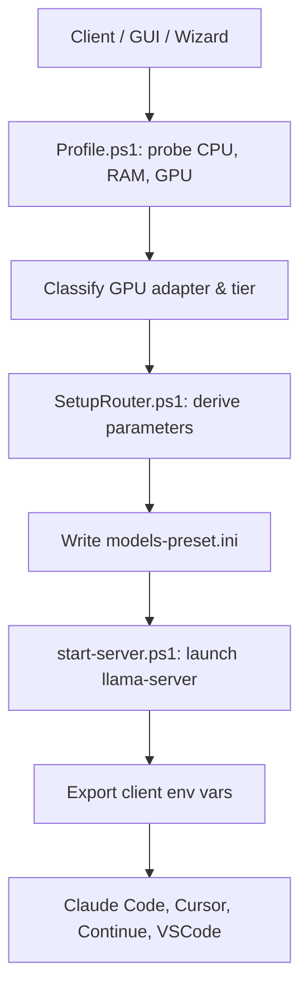

# Architecture

LLM Manager follows a two-stage design: first it **profiles** host hardware and classifies the GPU into a performance tier, then it **derives** optimal llama-server inference parameters from that classification plus any user overrides. The derived parameters are written to `models-preset.ini`, which llama-server consumes directly via `--models-preset`.

## Two-stage pipeline

## Stage 1 — Hardware profiling (`llo-core/Profile.ps1`)

The profiler runs on Windows, macOS, and Linux, guarded by `$IsWindows`, `$IsMacOS`, and `$IsLinux`. It detects:

* **CPU** — physical and logical core counts; optimal threads target physical P-cores, capped at 8 for Intel hybrid CPUs with more than 8 physical cores, floored at 4.
* **RAM** — total memory and a safe budget (total minus model size minus 512 MB runtime headroom).
* **GPU** — detected in priority order:
  1. `nvidia-smi` (preferred for NVIDIA; selects the GPU with most free memory)
  2. WMI `Win32_VideoController` (Windows fallback)
  3. `system_profiler SPDisplaysDataType` (macOS)
  4. `rocm-smi` (Linux)
  5. `/sys/class/drm` sysfs (Linux fallback)

Every GPU is classified on two orthogonal dimensions:

| Dimension | Values |
|---|---|
| `AdapterClass` (hardware identity) | `none`, `integrated`, `dedicated` |
| `PerformanceTier` (inference policy) | `cpu`, `low`, `mid`, `high` |

A 2 GB MX-class discrete GPU is still "dedicated" hardware but lands in the `cpu` tier because its VRAM is too small for useful offload.

## Stage 2 — Parameter derivation (`llo-core/SetupRouter.ps1`)

From the tier, `SetupRouter.ps1` derives:

* `n-gpu-layers` — 0 for CPU tier, `-1` (full offload) for GPU tiers
* `flash-attn` — off for CPU/integrated; on for GPU tiers (quantized KV cache requires it)
* KV cache precision (`cache_type_k` / `cache_type_v`) — `f16` for CPU tier; `q8_0` for GPU tiers (upgrades to `f16` when VRAM > 12 GB)
* Context size — computed from available RAM via a ceiling formula, floored at 4096 tokens
* Batch sizes — `ubatch` of 128 / 256 / 512 / 1024 by tier
* Parallel slots — `1` default; `2` for mid/high when RAM > 16 GB and VRAM > 4 GB
* Speculative decoding — `ngram-simple` for cpu/mid/high; `none` for low and for vision/MoE models

User-supplied `config.overrides` take absolute priority over every derived value. `start-server.ps1` also runs a port-collision scan: if port 8080 is occupied, it increments upward until a free socket is found and propagates the resolved port to all client environment URLs.

## CLI vs UI mathematical discrepancy

The CLI (`SetupRouter.ps1`) uses a simplified linear KV-cache approximation where `q8_0` is exactly 50% of `f16` and `q4_0` exactly 25%. The React diagnostics screen (`ui/src/lib/validation.ts`) uses precise element byte sizes (`f16` = 2.0 bytes, `q8_0` = 1.0625, `q4_0` = 0.5625), so `q8_0` is 53.1% of `f16` and `q4_0` is 28.1%. This causes a slight headroom-estimate mismatch between CLI output and the UI diagnostics.

## Context Manager Proxy (Python)

Enabled only when `context_manager.enabled = true`, launched via `script/StartContextManager.ps1` (default proxy port 8090, upstream 8080). It sits between clients and llama-server:

* `proxy.py` — Async HTTP client/server translating Anthropic envelopes to OpenAI, rewriting URLs to llama-server, handling sessions, streaming, and tool-call passthrough.
* `context_engine.py` — Per-session state, token counting, compression heuristics, summarization via llama-server, and disk checkpoints.
* `tokenizer_cache.py` — Shared HuggingFace tokenizer with alias normalization and a persistent token-count cache.
* `preset_reader.py` — Parses `models-preset.ini` to resolve active model aliases.
* `config.py` — Pydantic settings model (`ContextManagerConfig`).

Compression triggers when `prompt_tokens + max_tokens_requested >= ctx_limit * warn_threshold` (default 0.70). It keeps the last `keep_turns` turns uncompressed, summarizes the rest into a `[Compressed History Summary]` block, and clamps message tokens to 85% of `ctx_limit`.

## Tauri Desktop App (`ui/src-tauri/`)

Rust command handlers in `ui/src-tauri/src/commands/` dispatch PowerShell scripts via `scripts.rs` (`run_powershell_script` with `-File`). Key commands:

* `profile.rs` — `detect_hardware` returns a `SystemHardwareProfile` (CPU/RAM/GPU) serialized to JSON for the frontend.
* `server.rs` — Stops/stops server, tails `llama-server.log` and `llama-server.err.log` for the live log viewer.
* `config.rs` — Loads/saves `AppConfig` from the AppData config directory.
* `models.rs` — `scan_models` recursively collects `.gguf` files, parses metadata via `gguf.rs`, and resolves chat templates.
* `health.rs` — Server health checks.

The React frontend (`ui/src/`) has pages for Overview, Models, Performance, Diagnostics, Integrations, Logs, Settings, and Setup, with zustand stores (`configStore`, `hardwareStore`, `modelsStore`, `serverStore`, `validationStore`).

## Integration with related pages

- [Applications](../applications/index.md) — CLI, desktop app, context manager proxy
- [Systems](../systems/index.md) — profiling, parameter derivation, server lifecycle, GGUF management, configuration, compatibility guard
- [Features](../features/index.md) — adaptive inference, client routing, context compression, integrations, upstream compatibility
- [Getting started](getting-started.md) — how to install, build, test, and run
