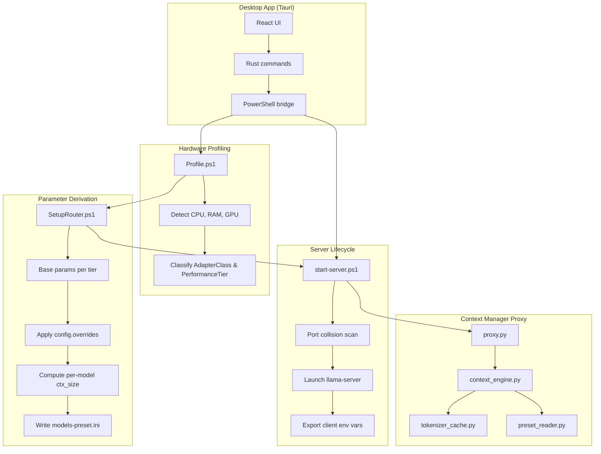

# LLM Manager

**Active contributors:** vijay

LLM Manager is a hardware-adaptive inference orchestrator for **llama.cpp** that automatically profiles host hardware at startup and derives optimal LLM inference parameters to maximize token throughput while preventing out-of-memory crashes. It runs on Windows, macOS, and Linux.

## What it does

1. **Profiles hardware** — Detects CPU cores, system RAM, GPU VRAM, and backend availability (CUDA, Metal, ROCm, Vulkan) across all three major platforms
2. **Classifies GPU into performance tiers** — `cpu` (no GPU or integrated), `low` (2–4 GB VRAM), `mid` (4–8 GB VRAM), `high` (>8 GB VRAM)
3. **Derives inference parameters** — GPU offload layers, KV cache precision, context window, batch size, speculative decoding, thread allocation
4. **Generates llama-server preset** — Writes `models-preset.ini` consumed directly by `llama-server --models-preset`
5. **Manages server lifecycle** — Starts/stops `llama-server` with port collision detection and auto-shift
6. **Optional context manager proxy** — Python proxy translating Anthropic → OpenAI protocol, compressing long sessions to fit context budget

## Who uses it

- Developers running local LLMs for coding assistance (Claude Code, Cursor, Continue, VS Code)
- Anyone wanting zero-config llama.cpp deployment that adapts to their hardware
- Teams needing consistent local inference across heterogeneous developer machines

## Quick links

- [Getting started](getting-started.md)
- [System architecture](architecture.md)
- [Hardware profiling](systems/hardware-profiling.md)
- [Inference parameter derivation](systems/parameter-derivation.md)
- [Tauri desktop application](applications/tauri-desktop-app.md)
- [Context manager proxy](applications/context-manager-proxy.md)
- [Client integrations](features/client-integrations.md)
- [Configuration reference](reference/configuration.md)

## High-level architecture



## Technology stack

| Layer | Technology |
|-------|------------|
| Core scripting | PowerShell 7+ (cross-platform) / PowerShell 5.1 (Windows) |
| Hardware profiling | WMI (Windows), sysctl/system_profiler (macOS), /proc + nvidia-smi/rocm-smi (Linux) |
| Desktop GUI | Tauri 2 + React 18 + TypeScript + Zustand |
| Rust backend | Tauri commands, async Tokio, serde JSON IPC |
| Context proxy | Python 3.10+, FastAPI, httpx, HuggingFace tokenizers |
| Upstream | llama.cpp (ggml-org/llama.cpp) |
| Testing | Pester (PowerShell), pytest (Python), Vitest (React), cargo test (Rust) |

## Key capabilities at a glance

| Capability | Description |
|------------|-------------|
| Hardware-adaptive inference | Auto-derives all llama.cpp flags from live hardware state |
| Cross-platform | Windows, macOS, Linux with platform-specific detection paths |
| GPU tier classification | 4 tiers (cpu, low, mid, high) with explicit VRAM thresholds |
| VRAM fit-throttle | Uses llama.cpp `--fit` + `--fit-target` to prevent OOM |
| KV cache quantization | Auto-selects f16/q8_0 based on tier and Flash Attention support |
| Context size formula | RAM-bound ceiling calculation with integration-aware floors |
| Speculative decoding | ngram-simple enabled for cpu/mid/high; disabled for low tier |
| Port collision protection | Auto-scans and shifts port if 8080 occupied |
| Multi-model hosting | `models-preset.ini` with per-model chat templates |
| Upstream compatibility guard | Parses `llama-server --help` and git history for breaking changes |
| Context manager proxy | Anthropic→OpenAI translation, session compression, checkpoint persistence |
| Desktop GUI | Real-time logs, hardware diagnostics, model switching, config sliders |
| Client integrations | VSCode tasks, Claude Code CLI, Cursor, Continue, Continue |

## Project structure

```
llm-manager/
├── main.ps1                    # Interactive setup wizard
├── run-setup.sh                # macOS/Linux entry point
├── llo-core/                   # PowerShell core library
│   ├── Profile.ps1             # Hardware profiler (CPU/RAM/GPU)
│   ├── SetupRouter.ps1         # Parameter derivation + preset generator
│   ├── ParseHelp.ps1           # llama-server --help parser
│   ├── GitDiff.ps1             # Upstream git change detector
│   ├── FetchAssets.ps1         # Template/grammar downloader (SHA-cached)
│   ├── Paths.ps1               # Config path resolution (AppData vs workspace)
│   └── context_manager/        # Python context proxy
│       ├── proxy.py            # FastAPI server, protocol translation
│       ├── context_engine.py   # Compression, token counting, checkpoints
│       ├── tokenizer_cache.py  # Shared HF tokenizer with alias normalization
│       ├── preset_reader.py    # models-preset.ini parser
│       └── config.py           # Pydantic settings model
├── script/                     # Operational scripts
│   ├── start-server.ps1        # Terminate old, run SetupRouter, launch server
│   ├── stop-server.ps1         # Graceful shutdown
│   ├── test-health.ps1         # Syntax, config, hardware, live ping checks
│   ├── verify-scripts.ps1      # Flag compatibility vs llama-server binary
│   └── StartContextManager.ps1 # Launch Python proxy
├── ui/                         # Tauri desktop application
│   ├── src/                    # React frontend
│   │   ├── pages/              # Overview, Models, Performance, Settings, Diagnostics, Logs, Integrations
│   │   ├── store/              # Zustand stores (hardware, config, server, models, validation)
│   │   └── lib/validation.ts   # Exact KV cache calculator (UI side)
│   └── src-tauri/              # Rust backend
│       ├── src/commands/       # Tauri command handlers
│       │   ├── config.rs       # Config load/save (AppData directory)
│       │   ├── profile.rs      # Hardware detection bridge
│       │   ├── server.rs       # Start/stop, log tailing
│       │   ├── models.rs       # GGUF scanner + binary header parser
│       │   ├── gguf.rs         # GGUF metadata extraction
│       │   └── health.rs       # Health check dispatcher
│       └── src/scripts.rs      # Workspace root resolution, PS dispatch
├── templates/                  # Jinja chat templates (synced from llama.cpp)
├── grammars/                   # GBNF grammars (synced from llama.cpp)
└── docs/                       # SYSTEM_COMMANDS.md (parameter reference)
```
