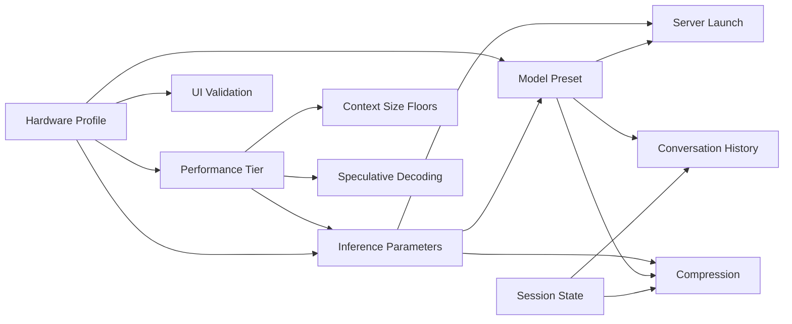

# Primitives

**Active contributors:** vijay

Foundational domain objects that appear across 3+ systems.

## Primitive overview

| Primitive | Description | Systems |
|-----------|-------------|---------|
| **Performance Tier** | Inference policy classification (cpu/low/mid/high) | Hardware Profiling, Parameter Derivation, Server Lifecycle, GGUF Management, UI |
| **Hardware Profile** | CPU/RAM/GPU detection output | Hardware Profiling, Parameter Derivation, Server Lifecycle, UI |
| **Inference Parameters** | Complete llama.cpp flag set derived from hardware | Parameter Derivation, Server Lifecycle, UI, Context Manager |
| **Model Preset** | `models-preset.ini` consumed by llama-server | Parameter Derivation, Server Lifecycle, Client Integrations |
| **Session State** | Conversation history + compression state | Context Manager Proxy, Client Integrations |

## Performance Tier

**Values:** `cpu`, `low`, `mid`, `high`

**Classification logic:**
```
AdapterClass = none/integrated → cpu
AdapterClass = dedicated + no backend → cpu
AdapterClass = dedicated + VRAM ≤ 2 GB → cpu
AdapterClass = dedicated + VRAM 2–4 GB → low
AdapterClass = dedicated + VRAM 4–8 GB → mid
AdapterClass = dedicated + VRAM > 8 GB → high
```

**Used by:**
- `SetupRouter.ps1` → selects base parameter table
- `Get-SafeContextSize` → integration-aware context floors
- `Get-ValidatedSpecType` → low tier forces `spec_type=none`
- `server.rs` → UI displays tier badge
- `validation.ts` → hardware safety checks

## Hardware Profile

**Structure (`SystemHardwareProfile`):**
```json
{
  "cpu": { "name": "", "physicalCores": 0, "logicalCores": 0, "optimalThreads": 0 },
  "ram": { "totalGb": 0, "safeBudgetMb": 0 },
  "gpu": { "name": "", "totalVramMb": 0, "adapterClass": "", "performanceTier": "", "reason": "" }
}
```

**Produced by:** `Profile.ps1` → `Get-SystemHardwareProfile`
**Consumed by:** `SetupRouter.ps1`, `start-server.ps1`, `profile.rs`, `hardwareStore.ts`

## Inference Parameters

**Complete flag set for llama-server:**

```powershell
@{
    n_gpu_layers  = 0 | -1
    flash_attn    = "on" | "off"
    use_fit       = $true | $false
    fit_target    = 0 | 512 | 1024
    fit_ctx_min   = 0 | 4096 | 8192
    cache_type_k  = "f16" | "q8_0" | "q4_0"
    cache_type_v  = "f16" | "q8_0" | "q4_0"
    ubatch_size   = 128 | 256 | 512 | 1024
    parallel      = 1 | 2
    spec_type     = "none" | "ngram-simple"
    context_shift = $true | $false
    cache_reuse   = 0 | 256
    mmap          = 1
}
```

**Derived by:** `SetupRouter.ps1` → `Get-InferenceParams`
**Override precedence:** `config.overrides` > hardware-derived > legacy > defaults
**Consumed by:** `models-preset.ini`, `start-server.ps1`, Context Manager, UI Performance page

## Model Preset

**Format (`models-preset.ini`):**
```ini
[model-alias]
model = /absolute/path/to/model.gguf
alias = model-alias
chat_template = /absolute/path/to/template.jinja
n_gpu_layers = -1
ctx_size = 32768
ubatch_size = 512
cache_type_k = q8_0
cache_type_v = q8_0
flash_attn = on
parallel = 1
spec_type = ngram-simple
context_shift = true
cache_reuse = 256
mmap = 1
```

**Generated by:** `SetupRouter.ps1` (per-model entries)
**Consumed by:** `llama-server --models-preset`, client model selection
**Location:** AppData directory (written at each server start)

## Session State

**Structure (`SessionState` in Context Manager):**
```python
class SessionState:
    session_id: str
    messages: List[Dict]           # Full conversation history
    compressed_history: List[Dict] # Summarized blocks
    last_accessed: float           # Unix timestamp
    checksum: str                  # SHA256 of turns-to-summarize
```

**Managed by:** `context_engine.py` → `ContextEngine`
**Persisted to:** `%APPDATA%\LLM Manager\checkpoints\{session_id}.json`
**Used by:** `proxy.py` (session extraction), compression, eviction

## Cross-system references



## Key source files

| Primitive | Key Files |
|-----------|-----------|
| Performance Tier | `llo-core/Profile.ps1` (classification), `llo-core/SetupRouter.ps1` (base tables) |
| Hardware Profile | `llo-core/Profile.ps1` (Get-SystemHardwareProfile), `ui/src-tauri/src/commands/profile.rs` |
| Inference Parameters | `llo-core/SetupRouter.ps1` (Get-InferenceParams), `ui/src/pages/Performance.tsx` |
| Model Preset | `llo-core/SetupRouter.ps1` (preset writer), `script/start-server.ps1` |
| Session State | `llo-core/context_manager/context_engine.py`, `llo-core/context_manager/proxy.py` |
