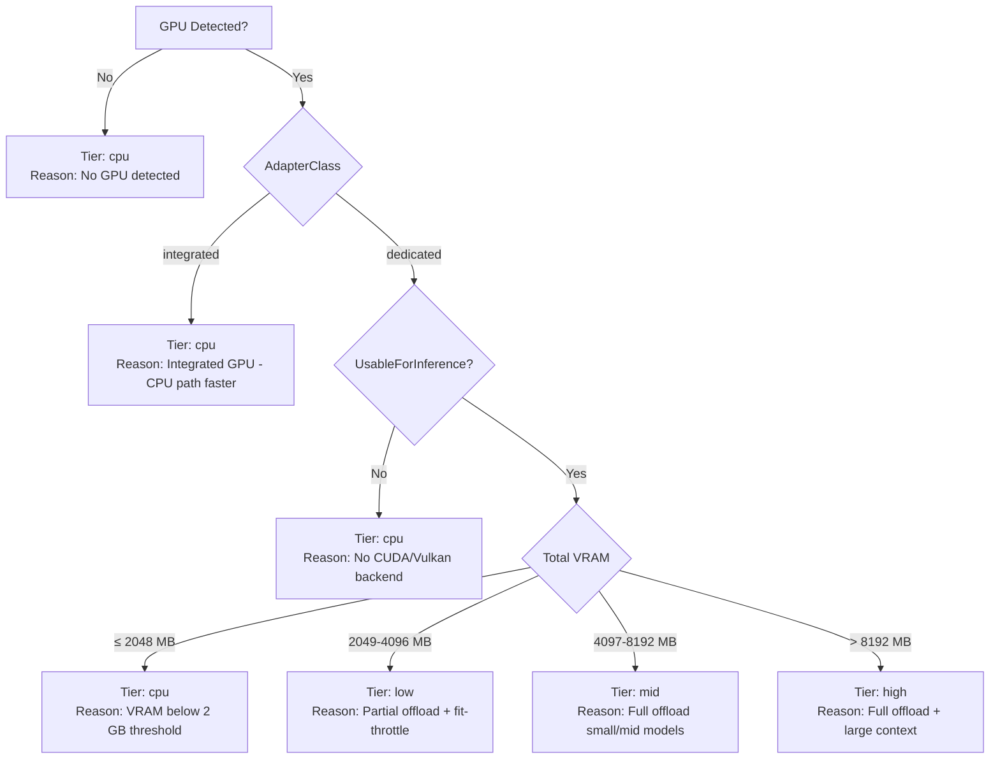

# Hardware Profiling

**Active contributors:** vijay

Cross-platform hardware detection and GPU tier classification system.

## Overview

`Profile.ps1` (PowerShell) and `profile.rs` (Tauri bridge) detect CPU, RAM, and GPU capabilities at startup. The output `SystemHardwareProfile` drives all downstream parameter derivation.

## Directory layout

```
llo-core/Profile.ps1              # Main profiler (PowerShell)
ui/src-tauri/src/commands/profile.rs  # Tauri command bridge
```

## Data structures

```json
// SystemHardwareProfile (JSON output)
{
  "cpu": {
    "name": "Intel Core i9-13900K",
    "physicalCores": 24,
    "logicalCores": 32,
    "optimalThreads": 8
  },
  "ram": {
    "totalGb": 64,
    "safeBudgetMb": 57344
  },
  "gpu": {
    "name": "NVIDIA GeForce RTX 4090",
    "totalVramMb": 24576,
    "adapterClass": "dedicated",
    "performanceTier": "high",
    "reason": "Dedicated GPU > 8GB VRAM"
  }
}
```

## CPU detection

| Platform | Method | Fields |
|----------|--------|--------|
| Windows | `Get-CimInstance Win32_Processor` | Name, NumberOfCores, NumberOfLogicalProcessors |
| macOS | `sysctl -n machdep.cpu.brand_string`, `hw.physicalcpu`, `hw.logicalcpu` | Brand, physical, logical |
| Linux | `/proc/cpuinfo` parsing | Model name, cpu cores, processor count |

**Optimal threads calculation:**
```powershell
$optimalThreads = $physicalCores
if ($cpuName -match "Intel" -and $physicalCores -gt 8) {
    $optimalThreads = 8  # P-core sweet spot for Intel hybrid
}
if ($optimalThreads -lt 4) { $optimalThreads = 4 }
```

## RAM detection

| Platform | Method |
|----------|--------|
| Windows | `Get-CimInstance Win32_ComputerSystem`.TotalPhysicalMemory |
| macOS | `sysctl -n hw.memsize` |
| Linux | `/proc/meminfo` → `MemTotal` (kB) |

**Safe budget calculation:**
```powershell
$totalRamMB = [math]::Round($totalRamBytes / 1MB, 0)
$safeRamMB = [math]::Round($totalRamMB - 6144, 0)  # Reserve 6 GB for OS
if ($safeRamMB -lt 4096) { $safeRamMB = 4096 }     # Floor at 4 GB
```

## GPU detection

### Detection priority

1. **nvidia-smi** (preferred for NVIDIA)
   - Paths: `C:\Program Files\NVIDIA Corporation\NVSMI\nvidia-smi.exe`, `C:\Windows\System32\nvidia-smi.exe`, `/usr/bin/nvidia-smi`, `/usr/local/bin/nvidia-smi`
   - Query: `--query-gpu=name,memory.total,memory.free,driver_version --format=csv,noheader,nounits`
   - Multi-GPU: picks device with most free VRAM
   - Sets: `adapterClass = dedicated`, `usableForInference = true`, `hasCudaBackend = true`

2. **WMI `Win32_VideoController`** (Windows fallback)
   - Filters: Name matches NVIDIA/AMD/Radeon/Intel/Arc
   - Shared-memory heuristic: `AdapterRAM ≈ TotalPhysicalMemory` (±256 MB) → integrated
   - Prefers dedicated adapters (non-shared memory)

3. **`system_profiler SPDisplaysDataType`** (macOS)
   - Detects Apple Silicon (M-series) unified memory
   - Detects discrete GPUs on Intel Macs
   - VRAM reported as 0 for unified memory (handled by tier logic)

4. **`rocm-smi`** (Linux AMD)
   - Requires ROCm installation
   - Parses VRAM from output

5. **`/sys/class/drm` sysfs** (Linux fallback)
   - Reads `mem_info_vram_total` from DRM subsystem
   - Works for any GPU with DRM driver

### AdapterClass classification

| Value | Condition |
|-------|-----------|
| `none` | No GPU detected by any method |
| `integrated` | Intel UHD/Iris/HD, AMD non-RX Radeon, or `AdapterRAM ≈ SystemRAM` |
| `dedicated` | Discrete GPU with confirmed onboard VRAM |

**Special case:** Intel Arc classified by VRAM + backend, not name alone.

### PerformanceTier classification



| Tier | VRAM Range | Typical Use Case |
|------|------------|------------------|
| `cpu` | No GPU / integrated / no backend / ≤2 GB | CPU-only inference |
| `low` | 2–4 GB | Partial offload, tight VRAM budget |
| `mid` | 4–8 GB | Full offload for 7B-13B models |
| `high` | >8 GB | Full offload, large models, long context |

**Tier reason string** printed at startup for user verification.

## Tauri bridge (`profile.rs`)

```rust
#[tauri::command]
pub fn detect_hardware() -> Result<SystemHardwareProfile, String> {
    let script_res = run_powershell_script("llo-core/Profile.ps1", &["-Json"])?;
    serde_json::from_str::<SystemHardwareProfile>(&script_res)
}
```

**Error handling:** On deserialization failure, writes raw output to `%APPDATA%\LLM Manager\logs\hardware_debug.log` for debugging.

## Key source files

| File | Purpose |
|------|---------|
| `llo-core/Profile.ps1` | Main profiler (Get-SystemHardwareProfile function) |
| `ui/src-tauri/src/commands/profile.rs` | Tauri command, JSON deserialization, debug logging |
| `ui/src/store/hardwareStore.ts` | Frontend state + fetchHardware() |
| `ui/src/pages/Overview.tsx` | Displays hardware profile with tier badge |
| `ui/src/pages/Diagnostics.tsx` | Detailed hardware validation |
