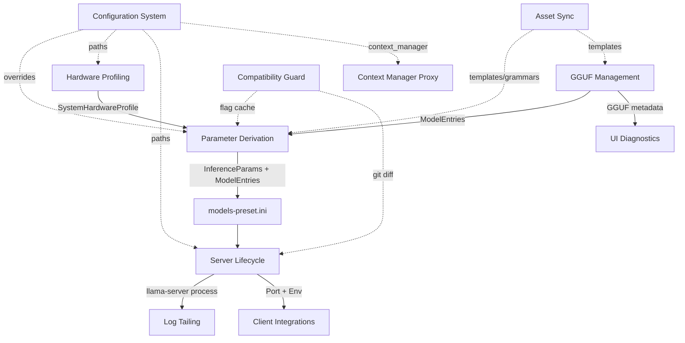

# Systems

**Active contributors:** vijay

Internal architectural components that don't map to a single application or package.

## System overview

| System | Purpose | Key Files |
|--------|---------|-----------|
| **Hardware Profiling** | Cross-platform CPU/RAM/GPU detection, tier classification | `llo-core/Profile.ps1`, `ui/src-tauri/src/commands/profile.rs` |
| **Parameter Derivation Engine** | Tier-based inference param tables, override application, per-model context calculation | `llo-core/SetupRouter.ps1` |
| **Server Lifecycle Manager** | Process management, port collision protection, log redirection, env export | `script/start-server.ps1`, `script/stop-server.ps1`, `ui/src-tauri/src/commands/server.rs` |
| **GGUF Model Management** | Recursive discovery, binary header parsing, template matching, mmproj pairing | `ui/src-tauri/src/commands/models.rs`, `ui/src-tauri/src/commands/gguf.rs` |
| **Configuration System** | AppData-based config, override precedence, legacy promotion, VSCode provisioning | `llo-core/Paths.ps1`, `ui/src-tauri/src/commands/config.rs`, `main.ps1` |
| **Upstream Compatibility Guard** | llama-server flag parsing, git change detection, asset sync | `llo-core/ParseHelp.ps1`, `llo-core/GitDiff.ps1`, `llo-core/FetchAssets.ps1` |

## Cross-system data flow

## Hardware Profiling

Detects CPU, RAM, GPU across Windows/macOS/Linux. Classifies GPU into `AdapterClass` (none/integrated/dedicated) and `PerformanceTier` (cpu/low/mid/high).

[Details →](hardware-profiling.md)

## Parameter Derivation Engine

Selects base parameter table per tier, applies conditional upgrades (`parallel=2`), enforces override precedence, computes per-model context size, validates speculative decoding compatibility.

[Details →](parameter-derivation.md)

## Server Lifecycle Manager

Terminates existing instances, runs parameter derivation, scans for port collisions, launches `llama-server` with preset, exports client environment variables, tails stdout/stderr to AppData logs.

[Details →](server-lifecycle.md)

## GGUF Model Management

Recursive directory scan for `.gguf` files, binary header parsing (architecture, quantization, context length, block count), chat template matching (exact → token → default → internal), multimodal projector (mmproj) detection and pairing.

[Details →](gguf-management.md)

## Configuration System

AppData directory as source of truth (`%APPDATA%\LLM Manager\llo-config.json`). Override precedence: `config.overrides` > hardware-derived > legacy flat keys (auto-promoted) > hardcoded defaults. VSCode workspace generation with OS-specific terminal env injection.

[Details →](configuration-system.md)

## Upstream Compatibility Guard

Two-pass `llama-server --help` parser with alias registration, SHA-cached template/grammar sync from ggml-org/llama.cpp, git commit scanner for breaking changes and hardware-impacting commits.

[Details →](compatibility-guard.md)
