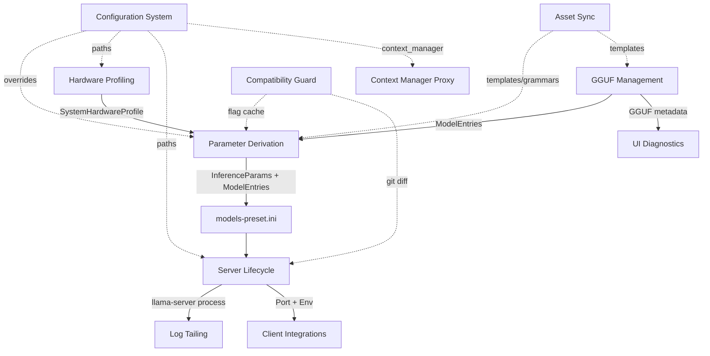

# Systems

**Active contributors:** vijay

Internal architectural components that don't map to a single application or package.

## System overview

| System | Purpose | Key Files |
|--------|---------|-----------|
| **Hardware Profiling** | Cross-platform CPU/RAM/GPU detection, tier classification | `llo-core/Profile.ps1`, `ui/src-tauri/src/commands/profile.rs` |
| **Parameter Derivation Engine** | Tier-based inference param tables, override application, per-model context calculation | `llo-core/SetupRouter.ps1` |
| **Server Lifecycle Manager** | Process management, port collision protection, log redirection, env export | `script/start-server.ps1`, `script/stop-server.ps1`, `ui/src-tauri/src/commands/server.rs` |
| **GGUF Model Management** | Recursive discovery, binary header parsing, template matching, mmproj pairing | `ui/src-tauri/src/commands/models.rs`, `ui/src-tauri/src/commands/gguf.rs` |
| **Configuration System** | AppData-based config, override precedence, legacy promotion, VSCode provisioning | `llo-core/Paths.ps1`, `ui/src-tauri/src/commands/config.rs`, `main.ps1` |
| **Upstream Compatibility Guard** | llama-server flag parsing, git change detection, asset sync | `llo-core/ParseHelp.ps1`, `llo-core/GitDiff.ps1`, `llo-core/FetchAssets.ps1` |

## Cross-system data flow



## Directory layout

```
droid-wiki/systems/
├── index.md                 # This index: lists the six systems
├── hardware-profiling.md    # CPU/RAM/GPU detection + tier classification
├── parameter-derivation.md  # Tier-based inference params + models-preset.ini
├── server-lifecycle.md      # Start/stop, port collision, env export
├── gguf-management.md       # Recursive GGUF scan + binary header parse
├── configuration-system.md  # AppData config + overrides + legacy promotion
└── compatibility-guard.md   # Flag parser + git scanner + asset sync
```

## Key Abstractions

| Abstraction | Responsibility | Primary Interface |
|-------------|---------------|-------------------|
| `SystemHardwareProfile` | CPU/RAM/GPU detection + GPU tier classification | `llo-core/Profile.ps1` → `Get-SystemHardwareProfile` |
| `InferenceParams` | Tier-based llama-server flags (n_gpu_layers, flash_attn, cache, batch, parallel, spec) | `llo-core/SetupRouter.ps1` → `Get-InferenceParams` |
| `models-preset.ini` | Serialized preset consumed by `llama-server --models-preset` | `llo-core/SetupRouter.ps1` (writer) |
| `ModelInfo` | Discovered GGUF file with parsed header metadata | `ui/src-tauri/src/commands/models.rs` → `scan_models` |
| `AppConfig` | User configuration with overrides block and sub-configs | `ui/src-tauri/src/commands/config.rs` → `load_config`/`save_config` |
| `PortReservation` | Collision-free socket for llama-server | `script/start-server.ps1` (port scanner) |
| `FlagCache` | Cached `llama-server --help` flags for compatibility auditing | `llo-core/ParseHelp.ps1` → `Update-CachedFlags` |

## Integration points

- **Configuration System** feeds `config.overrides` into Parameter Derivation (absolute priority), `context_manager` into the Python proxy, and `-ConfigFile` paths into all PowerShell scripts.
- **Server Lifecycle** launches `llama-server` with the preset from Parameter Derivation, then exports `ANTHROPIC_BASE_URL`/`ANTHROPIC_AUTH_TOKEN` env vars to clients.
- **GGUF Management** feeds `ModelInfo` entries back into Parameter Derivation for per-model context size and template matching.
- **Compatibility Guard** validates derived flags against the `llama-server` binary via `verify-scripts.ps1` and syncs templates used by GGUF Management.

## Hardware Profiling

Detects CPU, RAM, GPU across Windows/macOS/Linux. Classifies GPU into `AdapterClass` (none/integrated/dedicated) and `PerformanceTier` (cpu/low/mid/high).

[Details →](hardware-profiling.md)

## Parameter Derivation Engine

Selects base parameter table per tier, applies conditional upgrades (`parallel=2`), enforces override precedence, computes per-model context size, validates speculative decoding compatibility.

[Details →](parameter-derivation.md)

## Server Lifecycle Manager

Terminates existing instances, runs parameter derivation, scans for port collisions, launches `llama-server` with preset, exports client environment variables, tails stdout/stderr to AppData logs.

[Details →](server-lifecycle.md)

## GGUF Model Management

Recursive directory scan for `.gguf` files, binary header parsing (architecture, quantization, context length, block count), chat template matching (exact → token → default → internal), multimodal projector (mmproj) detection and pairing.

[Details →](gguf-management.md)

## Configuration System

AppData directory as source of truth (`%APPDATA%\LLM Manager\llo-config.json`). Override precedence: `config.overrides` > hardware-derived > legacy flat keys (auto-promoted) > hardcoded defaults. VSCode workspace generation with OS-specific terminal env injection.

[Details →](configuration-system.md)

## Upstream Compatibility Guard

Two-pass `llama-server --help` parser with alias registration, SHA-cached template/grammar sync from ggml-org/llama.cpp, git commit scanner for breaking changes and hardware-impacting commits.

[Details →](compatibility-guard.md)

## Entry Points for Modification

| Task | Entry Point | File |
|------|-------------|------|
| Add a new hardware system page | Create page in `droid-wiki/systems/` and register in this index | `droid-wiki/systems/index.md` |
| Change GPU tier thresholds | Edit tier classification logic | `llo-core/Profile.ps1` |
| Change base parameter table | Edit tier switch block | `llo-core/SetupRouter.ps1` |
| Change port collision scan range | Edit port scan loop | `script/start-server.ps1` |
| Add GGUF metadata field | Extend `GgufMetadata` struct and parser | `ui/src-tauri/src/commands/gguf.rs` |
| Add config key | Add to schema + Rust/TS `AppConfig` | `ui/src/lib/configSchema.ts`, `ui/src-tauri/src/commands/config.rs` |
| Add excluded flag pattern | Edit exclusion list | `script/verify-exclude.json` |

## Key source files

| File | Purpose |
|------|---------|
| `droid-wiki/systems/index.md` | This index: lists the six systems |
| `droid-wiki/systems/hardware-profiling.md` | Hardware Profiling system page |
| `droid-wiki/systems/parameter-derivation.md` | Parameter Derivation system page |
| `droid-wiki/systems/server-lifecycle.md` | Server Lifecycle system page |
| `droid-wiki/systems/gguf-management.md` | GGUF Management system page |
| `droid-wiki/systems/configuration-system.md` | Configuration System page |
| `droid-wiki/systems/compatibility-guard.md` | Compatibility Guard page |

## Related Pages

- [Architecture](../overview/architecture.md) — hardware classification, decision flow, core formulas
- [PowerShell CLI](../applications/powershell-cli.md) — CLI entry points
- [Tauri Desktop App](../applications/tauri-desktop-app.md) — Tauri desktop app command dispatch
- [Hardware-Adaptive Inference](../features/hardware-adaptive-inference.md) — adaptive inference feature
- [Upstream Compatibility](../features/upstream-compatibility.md) — llama.cpp argument tracking
