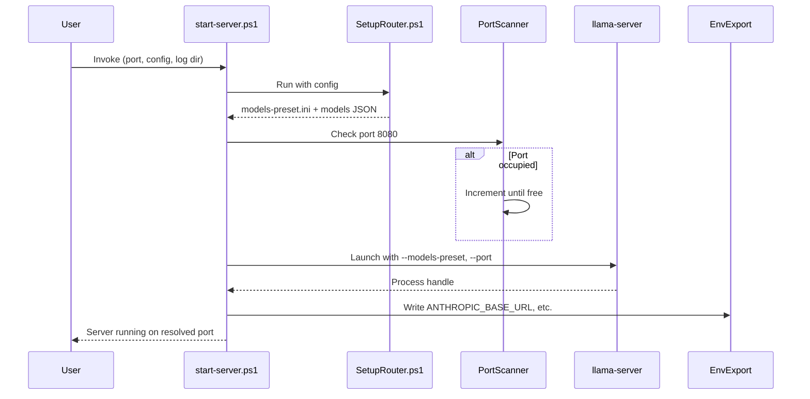

# Server Lifecycle Manager

**Active contributors:** vijay

Process management, port collision protection, log redirection, and client environment export.

## Overview

`start-server.ps1` and `stop-server.ps1` manage the `llama-server` process. The Tauri backend (`server.rs`) provides start/stop commands and real-time log tailing.

## Directory layout

```
script/
├── start-server.ps1        # Main startup script
├── stop-server.ps1         # Graceful shutdown
ui/src-tauri/src/commands/
├── server.rs               # Tauri commands: start, stop, status, log tailing
```

## Startup sequence (`start-server.ps1`)



### Detailed steps

1. **Load config** — Reads `llo-config.json` (AppData or `-ConfigFile`)
2. **Run SetupRouter** — Generates `models-preset.ini` + model list (via temp JSON file)
3. **Port collision scan** — .NET `IPGlobalProperties.GetIPGlobalProperties().GetActiveTcpListeners()`
   - Checks configured port (default 8080)
   - Increments until free socket found
4. **Launch llama-server** —
   ```powershell
   & $LlamaServer `
     --models-preset $PresetFile `
     --port $ResolvedPort `
     --host $HostAddr `
     --log-format text `
     --log-file $LogFile `
     --log-file-err $ErrLogFile
   ```
5. **Export client env vars** — Writes to shell profile / VSCode settings:
   - `ANTHROPIC_BASE_URL=http://127.0.0.1:<port>`
   - `ANTHROPIC_AUTH_TOKEN=local`
   - `CLAUDE_CODE_DISABLE_NONESSENTIAL_TRAFFIC=1`
   - `CLAUDE_CODE_ENABLE_GATEWAY_MODEL_DISCOVERY=1`

### Parameters

| Parameter | Default | Description |
|-----------|---------|-------------|
| `-Port` | 8080 | Server port (auto-shifted) |
| `-HostAddr` | 127.0.0.1 | Bind address |
| `-ConfigFile` | Auto-resolved | Path to `llo-config.json` |
| `-LogDir` | Auto-resolved | Log directory (AppData/logs) |
| `-ModelsDir` | From config | Override models directory |
| `-LlamaServer` | From config | Override binary path |

## Shutdown sequence (`stop-server.ps1`)

### Windows
```powershell
$processes = Get-CimInstance Win32_Process | Where-Object {
    $_.CommandLine -match "llama-server" -and $_.CommandLine -match $Port
}
foreach ($p in $processes) { Stop-Process -Id $p.ProcessId -Force }
```

### macOS/Linux
```powershell
# Try lsof first
$pids = lsof -ti:$Port 2>$null
if (-not $pids) {
    # Fallback to ss
    $pids = ss -tlnp | Where-Object { $_ -match ":$Port" } | ForEach-Object { ... }
}
foreach ($pid in $pids) { kill $pid }
```

## Tauri backend (`server.rs`)

### State management

```rust
static IS_RUNNING: AtomicBool = AtomicBool::new(false);
static IS_STARTING: AtomicBool = AtomicBool::new(false);
static ACTIVE_PORT: AtomicU16 = AtomicU16::new(8080);
static LOG_TAIL_TASKS: Mutex<Vec<JoinHandle<()>>> = Mutex::new(Vec::new());
```

### Start command

```rust
#[tauri::command]
pub async fn start_server(app: AppHandle, port: Option<u16>) -> Result<String, String> {
    // 1. Check IS_RUNNING/IS_STARTING flags
    // 2. Resolve config path, log dir, models dir
    // 3. Spawn blocking task: run_powershell_script("script/start-server.ps1", args)
    // 4. On success: IS_RUNNING=true, emit "server-status-changed": "running"
    // 5. Spawn log tailers for stdout/stderr
}
```

### Stop command

```rust
#[tauri::command]
pub async fn stop_server(app: AppHandle) -> Result<String, String> {
    // 1. Set IS_RUNNING=false, IS_STARTING=false
    // 2. Abort log tailers
    // 3. Spawn blocking: run_powershell_script("script/stop-server.ps1")
    // 4. Emit "server-status-changed": "stopped"
}
```

### Log tailing

```rust
async fn emit_log_file_lines(app: AppHandle, path: PathBuf, default_level: &str) {
    // Open file, seek to end
    // Loop: read new lines, classify level (I/W/E prefix)
    // Emit "server-log" Tauri event per line
    // Handle rotation/truncation (file size < current_pos)
    // Retry on missing file (wait for server to create)
}
```

**Log format (llama-server):**
```
0.00.030.349 I log_info: HTTP server listening on 127.0.0.1:8080
0.00.030.349 W log_warn: deprecated flag --old-flag
0.00.030.349 E log_error: failed to load model
```

**Level classification:** `I`→INFO, `W`→WARN, `E`→ERROR, else default.

### Status checking

```rust
pub fn check_server_status_internal() -> String {
    if IS_STARTING.load(...) {
        // Try TCP connect to port
        if connect_ok { IS_RUNNING=true; "running" } else { "starting" }
    } else if IS_RUNNING.load(...) {
        // Verify TCP connect still works
        if connect_ok { "running" } else { IS_RUNNING=false; "stopped" }
    } else {
        "stopped"
    }
}
```

## Client environment provisioning

### VSCode (generated by `main.ps1`)

`.vscode/settings.json`:
```json
{
  "terminal.integrated.env.windows": {
    "ANTHROPIC_BASE_URL": "http://127.0.0.1:8080",
    "ANTHROPIC_AUTH_TOKEN": "local",
    "CLAUDE_CODE_DISABLE_NONESSENTIAL_TRAFFIC": "1"
  },
  "terminal.integrated.env.osx": { ... },
  "terminal.integrated.env.linux": { ... }
}
```

### Shell profile (printed by `start-server.ps1`)

```powershell
$env:ANTHROPIC_BASE_URL = "http://127.0.0.1:8080"
$env:ANTHROPIC_AUTH_TOKEN = "local"
$env:CLAUDE_CODE_DISABLE_NONESSENTIAL_TRAFFIC = "1"
```

### Claude Code launch (Tauri command)

```rust
#[tauri::command]
pub fn launch_claude_terminal(port: Option<u16>, model: Option<String>) {
    // Checks context_manager.enabled in config
    // If enabled: uses proxy_port (8090), else server port
    // Sets env vars, spawns: powershell.exe -NoExit -Command "claude --model $env:_LLO_MODEL"
}
```

## Key source files

| File | Purpose |
|------|---------|
| `script/start-server.ps1` | Startup: config load, SetupRouter, port scan, launch, env export |
| `script/stop-server.ps1` | Cross-platform process termination |
| `ui/src-tauri/src/commands/server.rs` | Tauri commands: start, stop, status, log tailing |
| `ui/src-tauri/src/scripts.rs` | Workspace resolution, PS dispatch |
| `ui/src/store/serverStore.ts` | Frontend server state (status, port, logs) |
| `ui/src/pages/Overview.tsx` | Launch/stop buttons, live logs (100 lines) |
| `ui/src/pages/Logs.tsx` | Full log viewer with filtering |
